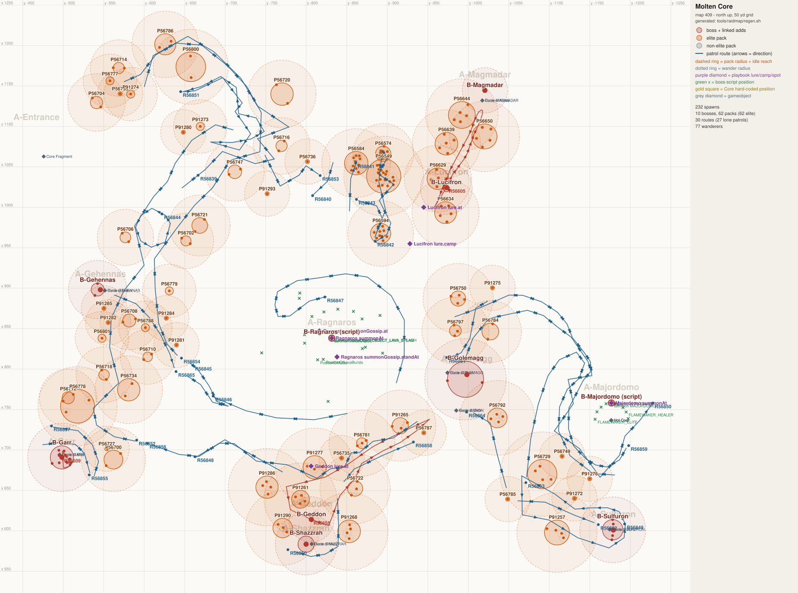
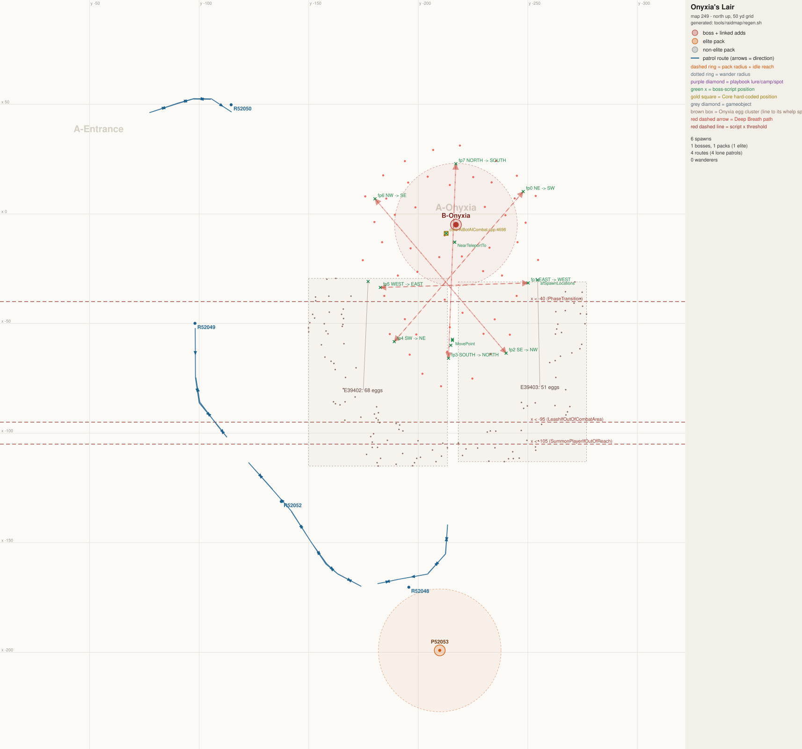

<!-- GENERATED by tools/raidmap/regen.sh (tools/raidmap/raid_map.py) - DO NOT HAND-EDIT. Change the generator or the data and regenerate. -->

# Raid map - Molten Core and Onyxia's Lair

Generated from the VMaNGOS world DB (`mangos`, read-only), the boss scripts, `SuiTacticScope.h`, the raid playbook and the autopilot's learned files and fight records on the VMaNGOS box. Fight data as of the newest record (mc 2026-11-18 03:18:54, onyxia 2026-11-18 18:43:16). Machine-readable twins: `raid-map/mc.json`, `raid-map/onyxia.json`.

**Ids are stable and derived from data, never running numbers**: attach tactics, wipes and notes to them.

| id | meaning |
|---|---|
| `B-<name>` | a boss and everything DB-linked to it (creature_groups/linking); scripted bosses with no spawn row (Majordomo, Ragnaros) use the same form |
| `P<guid>` | a pack: lowest spawn guid of its members |
| `R<guid>` | a waypoint route (movement_type 2), guid of the walker; a lone patroller's object id too |
| `A-<name>` | an area: the entrance or a boss |
| `E<guid>` | an Onyxia egg cluster: lowest egg gameobject guid |

## Rules

- **Packs**: connected components of `creature_groups` (leader-member), `creature_linking` and `creature_linking_template` edges; then single-linkage <= 12 yd (3D) attaches *ungrouped*, non-patrolling spawns to a neighbour. Proximity never merges two DB groups and never extends a patrolling component. A component with a rank-3 creature is a boss. A DB group whose members fall into clusters more than 30 yd apart is reported as **linked across**.
- **Reach**: 28 yd for an idle elite (the autopilot's credit), 34 yd for the kinds in the `wide-idle-pack-reach` registry row, template `detection_range` for non-elites. Reach ring = pack radius + reach. **Passes near** = a route comes within reach + 10 yd of a member spawn (3D, point-to-segment); within reach is marked **inside reach**. Playbook spots use the walker's reach. Neighbours are packs whose closest members are <= 40 yd apart.
- **Routes**: `creature_movement` by spawn guid, else `creature_movement_template` by entry (vmangos order). Paths are cyclic: a route whose last point is not on its first walks straight back. Lap time = length / speed + waits; speed = 2.5 yd/s x speed_walk, or 7.0 x speed_run when flags_extra has ALWAYS_RUN (0x40). Estimates, not measured.
- **Areas**: nearest anchor (3D distance from the object's centre). Anchors: the instance entrance (`areatrigger_teleport` target) and every boss (spawn row; else playbook `summonAt`; else the first script position naming it). This is a Voronoi split, not walls: an object near a boundary may sit in the neighbouring room - check its coordinates.
- **Fights** (`sui-autopilot-fights.jsonl`): each foe carries its spawn guid, so records map to objects exactly (an entry mismatch is dropped). The fight's object = the earliest foe whose entry is the record's `target`, else the earliest foe the raid struck first. Every other object in the record *joined* it (`unprovoked` = it struck the raid first). Summoned foes (Lava Spawn, whelps, Sons of Flame) are counted as summoned; Majordomo/Ragnaros and their script adds go to the scripted boss.
- **Entry swaps**: an instance script that calls `UpdateEntry(NPC_Y)` under `case NPC_X:` turns a spawn into another kind at runtime (MC: Firelord <-> Lava Annihilator, 50/50 per spawn per instance). Such members are named `X|Y`, both entries count for tactics/learned data, and fight foes of either entry map to the spawn.
- **Hazards** below are ranked by a simple score (closer + boss/camp/large pack first); they are computed facts, not advice.

## Molten Core (map 409)

232 spawns -> 10 bosses (2 scripted), 62 packs (62 elite), 30 routes (27 lone patrols), 77 wanderers; 7 playbook spots, 26 registry rows, 30 script positions, 0 Core hard-coded positions.

Fight records: 2236 on this map (boss-alive 6, win 1778, wipe 452), 2235 attached to objects, 1 with no mappable foe, 0 foe rows dropped for an entry mismatch.

### Hazard facts

**Spawns whose kind changes per instance** (1)

- 36 spawns are a coin flip per instance (instance_molten_core.cpp:242, instance_molten_core.cpp:252, instance_molten_core.cpp:376, instance_molten_core.cpp:386): Lava Annihilator -> Firelord; Firelord -> Lava Annihilator. Pack composition, Lava Spawn splitting (Firelord) and every tactic keyed on these entries change per lockout; the map shows both names

**DB groups that aggro together across a distance** (1)

- P56778 is ONE DB group (aggro together) split into 2 clusters 32 yd apart: Lava Annihilator|Firelord at (746.8, -503.6, -214.7); Lava Annihilator|Firelord at (761.5, -531.8, -214.4)

**Who joined whose fights (fight records)** (79, top 15)

- fight records: P91261 (Firewalker + Flameguard + 2x Lava Elemental) joined 36 of 68 fights on B-Geddon (Baron Geddon); 35 of those were wipes, 36 times it struck first (unprovoked)
- fight records: P56644 (5x Core Hound) joined 22 of 30 fights on B-Magmadar (Magmadar); 10 of those were wipes, 22 times it struck first (unprovoked)
- fight records: P56574 (10x Flame Imp) joined 28 of 61 fights on P56549 (20x Flame Imp); 0 of those were wipes, 20 times it struck first (unprovoked)
- fight records: P56629 (5x Core Hound) joined 18 of 58 fights on P56634 (5x Core Hound); 8 of those were wipes, 14 times it struck first (unprovoked)
- fight records: R56851 (Ancient Core Hound) joined 22 of 30 fights on P56720 (2x Firelord|Lava Annihilator); 1 of those were wipes, 22 times it struck first (unprovoked)
- fight records: R56853 (Ancient Core Hound) joined 22 of 29 fights on P91293 (Firelord|Lava Annihilator); 0 of those were wipes, 22 times it struck first (unprovoked)
- fight records: B-Geddon (Baron Geddon) joined 14 of 32 fights on P91261 (Firewalker + Flameguard + 2x Lava Elemental); 12 of those were wipes, 5 times it struck first (unprovoked)
- fight records: B-Lucifron (Lucifron + 2x Flamewaker Protector) joined 15 of 58 fights on P56634 (5x Core Hound); 10 of those were wipes, 12 times it struck first (unprovoked)
- fight records: P56650 (5x Core Hound) joined 20 of 40 fights on P56639 (5x Core Hound); 2 of those were wipes, 9 times it struck first (unprovoked)
- fight records: P56644 (5x Core Hound) joined 21 of 25 fights on P56650 (5x Core Hound); 0 of those were wipes, 16 times it struck first (unprovoked)
- fight records: P56735 (Lava Annihilator|Firelord) joined 11 of 68 fights on B-Geddon (Baron Geddon); 11 of those were wipes, 8 times it struck first (unprovoked)
- fight records: P56639 (5x Core Hound) joined 16 of 35 fights on P56629 (5x Core Hound); 3 of those were wipes, 12 times it struck first (unprovoked)
- fight records: B-Lucifron (Lucifron + 2x Flamewaker Protector) joined 12 of 35 fights on P56629 (5x Core Hound); 6 of those were wipes, 11 times it struck first (unprovoked)
- fight records: R56854 (Ancient Core Hound) joined 14 of 25 fights on P56786 (2x Lava Annihilator|Firelord); 2 of those were wipes, 14 times it struck first (unprovoked)
- fight records: P91274 (Firelord|Lava Annihilator) joined 13 of 30 fights on P56733 (Lava Annihilator|Firelord); 2 of those were wipes, 1 times it struck first (unprovoked)

**Routes passing inside an idle pack's / boss's / playbook spot's reach** (138, top 15)

- R56849 (Lava Surger, lone) passes 6 yd from B-Sulfuron (Sulfuron Harbinger + 4x Flamewaker Priest) at (588.9, -1177.3, -195.4) - inside its 28 yd reach
- R56855 (Ancient Core Hound, lone) passes 9 yd from B-Garr (Garr + 8x Firesworn) at (699.6, -494.7, -214.3) - inside its 28 yd reach
- R56859 (Ancient Core Hound, lone) passes 18 yd from B-Golemagg (Golemagg the Incinerator + 2x Core Rager) at (793.2, -998.3, -206.8) - inside its 28 yd reach
- R56865 (Ancient Core Hound, lone) passes 18 yd from B-Gehennas (Gehennas + 2x Flamewaker) at (898.1, -545.9, -203.4) - inside its 28 yd reach
- R56862 (Ancient Core Hound, lone) passes 23 yd from B-Sulfuron (Sulfuron Harbinger + 4x Flamewaker Priest) at (613.9, -1178.1, -195.6) - inside its 28 yd reach
- R56848 (Lava Surger, lone) passes 11 yd from playbook:Geddon lure.at  at (680.0, -806.0, -209.0) - inside its 28 yd reach
- R56852 (Ancient Core Hound, lone) passes 27 yd from B-Gehennas (Gehennas + 2x Flamewaker) at (898.1, -545.9, -203.4) - inside its 28 yd reach
- R56857 (Ancient Core Hound, lone) passes 27 yd from B-Garr (Garr + 8x Firesworn) at (699.6, -494.7, -214.3) - inside its 28 yd reach
- R56861 (Ancient Core Hound, lone) passes 28 yd from B-Golemagg (Golemagg the Incinerator + 2x Core Rager) at (793.2, -998.3, -206.8) - inside its 28 yd reach
- R56860 (Ancient Core Hound, lone) passes 13 yd from B-Shazzrah (Shazzrah) at (583.5, -799.8, -205.4) - inside its 28 yd reach
- R56842 (Lava Surger, lone) passes 0 yd from P56549 (20x Flame Imp) at (1027.8, -907.5, -161.5) - inside its 28 yd reach
- R56842 (Lava Surger, lone) passes 0 yd from P56574 (10x Flame Imp) at (1069.0, -895.0, -157.0) - inside its 28 yd reach
- R56843 (Lava Surger, lone) passes 0 yd from P56574 (10x Flame Imp) at (1063.9, -893.5, -157.0) - inside its 28 yd reach
- R56605 (Lucifron, owned by B-Lucifron) passes 1 yd from P56629 (5x Core Hound) at (1034.7, -972.4, -181.2) - inside its 28 yd reach
- R56843 (Lava Surger, lone) passes 1 yd from P56594 (10x Flame Imp) at (976.0, -888.6, -171.9) - inside its 28 yd reach

**Idle elite packs within each other's reach** (29, top 15)

- B-Lucifron (Lucifron + 2x Flamewaker Protector) and P56629 (5x Core Hound) stand 8 yd apart (56607 -> 56631): inside idle reach
- B-Gehennas (Gehennas + 2x Flamewaker) and P91285 (Firelord|Lava Annihilator) stand 20 yd apart (56739 -> 91285): inside idle reach
- B-Lucifron (Lucifron + 2x Flamewaker Protector) and P56634 (5x Core Hound) stand 20 yd apart (56606 -> 56638): inside idle reach
- P56644 (5x Core Hound) and B-Magmadar (Magmadar) stand 28 yd apart (56647 -> 56683): inside idle reach
- B-Shazzrah (Shazzrah) and P91290 (Firewalker + Flameguard + Lava Reaver) stand 28 yd apart (56608 -> 91292): inside idle reach
- P56549 (20x Flame Imp) and P56574 (10x Flame Imp) stand 8 yd apart (56556 -> 56582): inside idle reach
- P56733 (Lava Annihilator|Firelord) and P91274 (Firelord|Lava Annihilator) stand 13 yd apart (56733 -> 91274): inside idle reach
- P56712 (2x Molten Destroyer) and P56778 (2x Lava Annihilator|Firelord) stand 14 yd apart (56712 -> 56778): inside idle reach
- P56702 (Molten Destroyer + Molten Giant) and P56721 (Firelord|Lava Annihilator + Lava Annihilator|Firelord) stand 16 yd apart (56702 -> 56721): inside idle reach
- P56708 (Molten Destroyer + Molten Giant) and P56788 (Lava Annihilator|Firelord) stand 16 yd apart (56708 -> 56788): inside idle reach
- P56714 (2x Molten Giant) and P56777 (Firelord|Lava Annihilator) stand 17 yd apart (56714 -> 56777): inside idle reach
- P56708 (Molten Destroyer + Molten Giant) and P91282 (Lava Annihilator|Firelord) stand 18 yd apart (56709 -> 91282): inside idle reach
- P91282 (Lava Annihilator|Firelord) and P91285 (Firelord|Lava Annihilator) stand 18 yd apart (91282 -> 91285): inside idle reach
- P56700 (2x Molten Destroyer) and P56727 (Lava Annihilator|Firelord) stand 18 yd apart (56700 -> 56727): inside idle reach
- P56733 (Lava Annihilator|Firelord) and P56777 (Firelord|Lava Annihilator) stand 20 yd apart (56733 -> 56777): inside idle reach

**Playbook spots inside an idle pack's reach** (2)

- playbook Geddon lure.at (680.0, -806.0, -209.0) is 5 yd from P91277 (Firewalker + Flameguard + Lava Reaver) - inside its idle reach
- playbook Lucifron lure.at (1000.0, -945.0, -180.0) is 22 yd from P56634 (5x Core Hound) - inside its idle reach

**Playbook spots near a patrol route** (4)

- playbook Geddon lure.at (680.0, -806.0, -209.0) is 11 yd from patrol R56848 (Lava Surger)
- playbook Lucifron lure.camp (955.0, -928.0, -180.0) is 31 yd from patrol R56842 (Lava Surger)
- playbook Geddon lure.at (680.0, -806.0, -209.0) is 36 yd from patrol R56856 (Ancient Core Hound)
- playbook Ragnaros summonGossip.at (847.1, -816.2, -229.8) is 37 yd from patrol R56847 (Lava Surger)

**Elites that respawn in under 2 h** (36, top 15)

- P56549 (20x Flame Imp) respawns every 5 min
- P56574 (10x Flame Imp) respawns every 5 min
- P56584 (10x Flame Imp) respawns every 5 min
- P56594 (10x Flame Imp) respawns every 5 min
- R56851 (Ancient Core Hound) respawns every 18 min
- R56852 (Ancient Core Hound) respawns every 18 min
- R56853 (Ancient Core Hound) respawns every 18 min
- R56854 (Ancient Core Hound) respawns every 18 min
- R56855 (Ancient Core Hound) respawns every 18 min
- R56856 (Ancient Core Hound) respawns every 18 min
- R56857 (Ancient Core Hound) respawns every 18 min
- R56858 (Ancient Core Hound) respawns every 18 min
- R56859 (Ancient Core Hound) respawns every 18 min
- R56860 (Ancient Core Hound) respawns every 18 min
- R56861 (Ancient Core Hound) respawns every 18 min

All hazards, ranked, with their ids: `raid-map/mc.json` -> `hazards`.

### Areas

| area | anchor | at | bosses | packs | elites | lone patrols |
|---|---|---|---|---|---|---|
| A-Entrance | Entrance (areatrigger_teleport 2886 (Molten Core - Entrance)) | (1091.9, -467.0, -105.1) | - | 9 | 14 | 1 |
| A-Lucifron | Lucifron (spawn guid 56605) | (1024.4, -973.3, -181.5) | B-Lucifron | 10 | 78 | 5 |
| A-Magmadar | Magmadar (spawn guid 56683) | (1144.6, -1020.5, -185.7) | B-Magmadar | 2 | 11 | 0 |
| A-Gehennas | Gehennas (spawn guid 56737) | (898.1, -545.9, -203.4) | B-Gehennas | 14 | 29 | 5 |
| A-Garr | Garr (spawn guid 56609) | (691.0, -498.4, -214.3) | B-Garr | 5 | 22 | 4 |
| A-Geddon | Baron Geddon (spawn guid 56655) | (614.0, -806.3, -207.0) | B-Geddon | 7 | 24 | 1 |
| A-Shazzrah | Shazzrah (spawn guid 56608) | (583.5, -799.8, -205.4) | B-Shazzrah | 1 | 5 | 1 |
| A-Golemagg | Golemagg the Incinerator (spawn guid 56684) | (793.2, -998.3, -206.8) | B-Golemagg | 7 | 24 | 3 |
| A-Sulfuron | Sulfuron Harbinger (spawn guid 56677) | (601.1, -1179.1, -195.9) | B-Sulfuron | 5 | 19 | 3 |
| A-Majordomo | Majordomo Executus (playbook summonAt) | (758.1, -1176.7, -118.6) | B-Majordomo | 1 | 3 | 2 |
| A-Ragnaros | Ragnaros (playbook summonAt) | (838.3, -831.5, -232.2) | B-Ragnaros | 1 | 3 | 2 |

### Area A-Entrance

#### P56704 - 2x Molten Giant

- **elite pack**, 2 spawn(s); centre (1129.6, -541.1, -107.4), radius 8 yd, reach ring 36 yd; 2 elite(s); spawns 56704-56705
- entries 11658; respawn 6 h
- DB link: creature_groups leader 56704; flags 0x02 = aggro together
- neighbours <= 40 yd: P56733 30 yd, P56777 31 yd
- learned: Molten Giant: pulse 10 yd, burst rhythm 19.7 s
- fights: 29 fights as the pulled target (29 win / 0 wipe), 1 member deaths; last 7 d: 26 (26/0); last 2026-11-17 23:13:36 win; joined by P56777 x1 (0 wipe, 0 unprovoked); summoned/unmapped foes Frostmane Troll Whelp x6, Lava Spawn x2

#### P56714 - 2x Molten Giant

- **elite pack**, 2 spawn(s); centre (1172.2, -568.6, -112.8), radius 7 yd, reach ring 35 yd; 2 elite(s); spawns 56714-56715
- entries 11658; respawn 6 h
- DB link: creature_groups leader 56714; flags 0x0E = aggro together, evade together, respawn together
- neighbours <= 40 yd: P56777 17 yd **inside reach**, P56733 32 yd, P91274 33 yd
- patrols passing: R56854 15 yd **inside reach**, R56839 30 yd
- learned: Molten Giant: pulse 10 yd, burst rhythm 19.7 s
- fights: 29 fights as the pulled target (29 win / 0 wipe), 0 member deaths; last 7 d: 26 (26/0); last 2026-11-17 23:19:03 win; joined by R56854 x1 (0 wipe, 1 unprovoked), R56839 x1 (0 wipe, 1 unprovoked); joined other fights 2 times (2 unprovoked): P56777 x1, P56733 x1

#### P56786 - 2x Lava Annihilator|Firelord

- **elite pack**, 2 spawn(s); centre (1201.5, -626.0, -124.2), radius 13 yd, reach ring 41 yd; 2 elite(s); spawns 56786, 56796
- entries 11665, 11668; respawn 3 h
- DB link: creature_groups leader 56786; flags 0x02 = aggro together
- wanders: 56786 5 yd, 56796 5 yd
- neighbours <= 40 yd: P56800 30 yd
- patrols passing: R56839 5 yd **inside reach**, R56854 5 yd **inside reach**
- registry tactics: `spawner-first-for-ranged`
- learned: Lava Annihilator: rebounder
- fights: 25 fights as the pulled target (22 win / 3 wipe), 125 member deaths; last 7 d: 22 (20/2); last 2026-11-17 23:22:09 win; joined by R56854 x14 (2 wipe, 14 unprovoked), R56839 x8 (2 wipe, 7 unprovoked), P56800 x1 (1 wipe, 0 unprovoked); joined other fights 7 times (3 unprovoked): R56854 x5, R56839 x2; summoned/unmapped foes Lava Spawn x357

#### P56800 - Firelord|Lava Annihilator + Lava Annihilator|Firelord

- **elite pack**, 2 spawn(s); centre (1173.7, -657.5, -129.6), radius 18 yd, reach ring 46 yd; 2 elite(s); spawns 56800, 91256
- entries 11665, 11668; respawn 2 h, 3 h
- DB link: creature_groups leader 56800; flags 0x02 = aggro together
- wanders: 56800 5 yd, 91256 5 yd
- neighbours <= 40 yd: P56786 30 yd
- patrols passing: R56851 14 yd **inside reach**, R56854 15 yd **inside reach**, R56839 19 yd **inside reach**
- registry tactics: `spawner-first-for-ranged`
- learned: Lava Annihilator: rebounder
- fights: 29 fights as the pulled target (27 win / 2 wipe), 64 member deaths; last 7 d: 27 (25/2); last 2026-11-17 23:24:06 win; joined by R56854 x13 (1 wipe, 13 unprovoked), P56733 x1 (1 wipe, 1 unprovoked), P91274 x1 (1 wipe, 1 unprovoked), P91285 x1 (1 wipe, 1 unprovoked), R56844 x1 (1 wipe, 1 unprovoked); joined other fights 3 times (1 unprovoked): R56839 x2, P56786 x1; summoned/unmapped foes Lava Spawn x341

#### P56733 - Lava Annihilator|Firelord

- **elite pack**, 1 spawn(s); centre (1140.4, -570.3, -112.6), radius 0 yd, reach ring 28 yd; 1 elite(s); spawns 56733
- entries 11665, 11668; respawn 3 h
- DB link: none (single spawn)
- neighbours <= 40 yd: P91274 13 yd **inside reach**, P56777 20 yd **inside reach**, P56704 30 yd, P56714 32 yd
- patrols passing: R56854 16 yd **inside reach**, R56839 31 yd
- registry tactics: `spawner-first-for-ranged`
- learned: Lava Annihilator: rebounder
- fights: 30 fights as the pulled target (28 win / 2 wipe), 79 member deaths; last 7 d: 26 (26/0); last 2026-11-17 23:16:29 win; joined by P91274 x13 (2 wipe, 1 unprovoked), P56777 x5 (2 wipe, 3 unprovoked), R56839 x3 (2 wipe, 2 unprovoked), P56714 x1 (1 wipe, 1 unprovoked); joined other fights 3 times (2 unprovoked): P56777 x1, P56629 x1, P56800 x1; summoned/unmapped foes Lava Spawn x269

#### P56777 - Firelord|Lava Annihilator

- **elite pack**, 1 spawn(s); centre (1156.4, -557.7, -111.9), radius 5 yd, reach ring 33 yd; 1 elite(s); spawns 56777
- entries 11665, 11668; respawn 2 h
- DB link: none (single spawn)
- wanders: 56777 5 yd
- neighbours <= 40 yd: P56714 17 yd **inside reach**, P56733 20 yd **inside reach**, P91274 30 yd, P56704 31 yd
- patrols passing: R56854 17 yd **inside reach**
- registry tactics: `spawner-first-for-ranged`
- learned: Lava Annihilator: rebounder
- fights: 23 fights as the pulled target (22 win / 1 wipe), 39 member deaths; last 7 d: 19 (19/0); last 2026-11-17 23:17:16 win; joined by P56714 x1 (1 wipe, 1 unprovoked), P56733 x1 (1 wipe, 0 unprovoked), P91274 x1 (1 wipe, 0 unprovoked), R56854 x1 (1 wipe, 1 unprovoked), R56839 x1 (1 wipe, 1 unprovoked); joined other fights 11 times (5 unprovoked): P56733 x5, P91274 x3, B-Ragnaros x2, P56704 x1; summoned/unmapped foes Lava Spawn x10

#### P91273 - Lava Annihilator|Firelord

- **elite pack**, 1 spawn(s); centre (1100.0, -669.2, -154.4), radius 5 yd, reach ring 33 yd; 1 elite(s); spawns 91273
- entries 11665, 11668; respawn 3 h
- DB link: none (single spawn)
- wanders: 91273 5 yd
- neighbours <= 40 yd: P91280 22 yd **inside reach**
- patrols passing: R56852 9 yd **inside reach**, R56851 24 yd **inside reach**
- registry tactics: `spawner-first-for-ranged`
- learned: Lava Annihilator: rebounder
- fights: 26 fights as the pulled target (26 win / 0 wipe), 0 member deaths; last 7 d: 23 (23/0); last 2026-11-18 00:19:48 win; joined by R56851 x1 (0 wipe, 1 unprovoked), R56852 x1 (0 wipe, 1 unprovoked), P91280 x1 (0 wipe, 1 unprovoked); joined other fights 2 times (0 unprovoked): P56747 x1, R56851 x1; summoned/unmapped foes Lava Spawn x7

#### P91274 - Firelord|Lava Annihilator

- **elite pack**, 1 spawn(s); centre (1140.0, -583.3, -112.8), radius 5 yd, reach ring 33 yd; 1 elite(s); spawns 91274
- entries 11665, 11668; respawn 2 h
- DB link: none (single spawn)
- wanders: 91274 5 yd
- neighbours <= 40 yd: P56733 13 yd **inside reach**, P56777 30 yd, P56714 33 yd
- patrols passing: R56854 17 yd **inside reach**, R56839 19 yd **inside reach**
- registry tactics: `spawner-first-for-ranged`
- learned: Lava Annihilator: rebounder
- fights: 17 fights as the pulled target (17 win / 0 wipe), 0 member deaths; last 7 d: 16 (16/0); last 2026-11-17 23:18:02 win; joined by P56777 x3 (0 wipe, 1 unprovoked), R56839 x2 (0 wipe, 2 unprovoked); joined other fights 16 times (2 unprovoked): P56733 x13, P56777 x1, B-Ragnaros x1, P56800 x1; summoned/unmapped foes Lava Spawn x8

#### P91280 - Firelord|Lava Annihilator

- **elite pack**, 1 spawn(s); centre (1092.8, -648.3, -152.6), radius 0 yd, reach ring 28 yd; 1 elite(s); spawns 91280
- entries 11665, 11668; respawn 2 h
- DB link: none (single spawn)
- neighbours <= 40 yd: P91273 22 yd **inside reach**
- patrols passing: R56852 16 yd **inside reach**, R56851 36 yd
- registry tactics: `spawner-first-for-ranged`
- learned: Lava Annihilator: rebounder
- fights: 28 fights as the pulled target (28 win / 0 wipe), 0 member deaths; last 7 d: 25 (25/0); last 2026-11-18 00:20:42 win; joined by R56852 x3 (0 wipe, 3 unprovoked); joined other fights 1 times (1 unprovoked): P91273 x1; summoned/unmapped foes Lava Spawn x15, Cat x1

Lone patrols starting here: R56851 (see Patrols).

### Area A-Lucifron

#### B-Lucifron - Lucifron

- **boss**, Lucifron + 2x Flamewaker Protector; centre (1023.1, -972.9, -181.5), radius 4 yd, reach ring 32 yd; 3 elite(s); spawns 56605-56607
- entries 12118, 12119; respawn 2 h, 7 d
- DB link: creature_groups leader 56605; flags 0x17 = formation move, aggro together, evade together, respawn all on master evade
- walks: R56605 (271 yd back-and-forth along a 136 yd line (way out and way back within 10 yd), ~108 s per lap)
- neighbours <= 40 yd: P56629 8 yd **inside reach**, P56634 20 yd **inside reach**
- playbook spots near: Lucifron lure.at 34 yd
- registry tactics: `patrol-backoff-whole-raid`, `backoff-away-from-walker`
- fights: 21 fights as the pulled target (17 win / 4 wipe), 184 member deaths; last 7 d: 16 (14/2); last 2026-11-17 23:58:42 win; joined by P56634 x6 (3 wipe, 5 unprovoked), P56629 x4 (1 wipe, 3 unprovoked); joined other fights 34 times (29 unprovoked): P56634 x15, P56629 x12, P56639 x5, P56747 x1, P56650 x1; summoned/unmapped foes Cat x12, Imp x6

#### P56549 - 20x Flame Imp

- **elite pack**, 20 spawn(s); centre (1038.6, -895.6, -159.2), radius 21 yd, reach ring 49 yd; 20 elite(s); spawns 56549, 56555-56573
- entries 11669; respawn 5 min-8 min
- DB link: creature_groups leader 56557; flags 0x0E = aggro together, evade together, respawn together
- wanders: 56568 5 yd, 56569 5 yd, 56573 5 yd
- neighbours <= 40 yd: P56574 8 yd **inside reach**, P56584 23 yd **inside reach**
- patrols passing: R56842 0 yd **inside reach**, R56843 1 yd **inside reach**, R56841 26 yd **inside reach**
- playbook spots near: Lucifron lure.at 50 yd
- learned: Flame Imp: pulse 10 yd, burst rhythm 17.0 s
- fights: 61 fights as the pulled target (55 win / 6 wipe), 301 member deaths; last 7 d: 52 (49/3); last 2026-11-17 23:45:01 win; joined by P56574 x28 (0 wipe, 20 unprovoked), R56842 x8 (5 wipe, 6 unprovoked), P56594 x2 (2 wipe, 2 unprovoked), R56843 x1 (0 wipe, 1 unprovoked), P56629 x1 (0 wipe, 1 unprovoked); joined other fights 2 times (2 unprovoked): R56842 x1, R56843 x1

#### P56574 - 10x Flame Imp

- **elite pack**, 10 spawn(s); centre (1066.1, -895.0, -157.2), radius 10 yd, reach ring 38 yd; 10 elite(s); spawns 56574-56583
- entries 11669; respawn 5 min-8 min
- DB link: creature_groups leader 56574; flags 0x0E = aggro together, evade together, respawn together
- neighbours <= 40 yd: P56549 8 yd **inside reach**, P56584 24 yd **inside reach**
- patrols passing: R56842 0 yd **inside reach**, R56843 0 yd **inside reach**, R56841 28 yd
- learned: Flame Imp: pulse 10 yd, burst rhythm 17.0 s
- fights: 17 fights as the pulled target (17 win / 0 wipe), 0 member deaths; last 7 d: 15 (15/0); last 2026-11-17 20:45:59 win; joined other fights 28 times (20 unprovoked): P56549 x28

#### P56584 - 10x Flame Imp

- **elite pack**, 10 spawn(s); centre (1054.6, -861.7, -159.1), radius 14 yd, reach ring 42 yd; 10 elite(s); spawns 56584-56593
- entries 11669; respawn 5 min-8 min
- DB link: creature_groups leader 56584; flags 0x0E = aggro together, evade together, respawn together
- wanders: 56584 3 yd, 56585 3 yd, 56586 3 yd, 56587 3 yd, 56588 3 yd, 56589 3 yd, 56590 3 yd, 56591 3 yd, 56592 3 yd, 56593 3 yd
- neighbours <= 40 yd: P56549 23 yd **inside reach**, P56574 24 yd **inside reach**
- patrols passing: R56841 2 yd **inside reach**, R56842 25 yd **inside reach**, R56840 25 yd **inside reach**, R56843 26 yd **inside reach**
- learned: Flame Imp: pulse 10 yd, burst rhythm 17.0 s
- fights: 14 fights as the pulled target (14 win / 0 wipe), 6 member deaths; last 7 d: 11 (11/0); last 2026-11-17 12:53:34 win; joined by R56841 x11 (0 wipe, 6 unprovoked), R56843 x10 (0 wipe, 8 unprovoked), R56842 x1 (0 wipe, 1 unprovoked); joined other fights 16 times (16 unprovoked): R56841 x12, R56843 x3, R56842 x1

#### P56594 - 10x Flame Imp

- **elite pack**, 10 spawn(s); centre (967.6, -891.8, -173.6), radius 12 yd, reach ring 40 yd; 10 elite(s); spawns 56594-56599, 56601-56604
- entries 11669; respawn 5 min-8 min
- DB link: creature_groups leader 56594; flags 0x0E = aggro together, evade together, respawn together
- wanders: 56594 3 yd, 56595 3 yd, 56596 3 yd, 56597 3 yd, 56598 3 yd, 56599 3 yd, 56601 3 yd, 56602 3 yd, 56603 3 yd, 56604 3 yd
- patrols passing: R56843 1 yd **inside reach**, R56842 2 yd **inside reach**
- playbook spots near: Lucifron lure.at 56 yd, Lucifron lure.camp 30 yd
- learned: Flame Imp: pulse 10 yd, burst rhythm 17.0 s
- fights: 25 fights as the pulled target (25 win / 0 wipe), 1 member deaths; last 7 d: 22 (22/0); last 2026-11-17 23:46:37 win; joined by R56842 x1 (0 wipe, 0 unprovoked); joined other fights 11 times (11 unprovoked): P56634 x3, R56842 x3, P56549 x2, R56843 x2, R56839 x1

#### P56629 - 5x Core Hound

- **elite pack**, 5 spawn(s); centre (1035.4, -962.4, -179.8), radius 13 yd, reach ring 41 yd; 5 elite(s); spawns 56629-56633
- entries 11671; respawn 1 h
- DB link: creature_groups leader 56629; flags 0x2E = aggro together, evade together, respawn together, respawn all on any evade
- wanders: 56629 2 yd, 56630 2 yd, 56631 2 yd, 56632 2 yd, 56633 2 yd
- neighbours <= 40 yd: B-Lucifron 8 yd **inside reach**, P56639 24 yd **inside reach**, P56634 25 yd **inside reach**
- patrols passing: R56605 (B-Lucifron) 1 yd **inside reach**
- playbook spots near: Lucifron lure.at 30 yd
- registry tactics: `floored-riser-no-damage`, `riser-burst-focus`, `riser-keeps-fight-open`
- learned: Core Hound: riser
- fights: 35 fights as the pulled target (28 win / 7 wipe), 213 member deaths; last 7 d: 29 (23/6); last 2026-11-18 00:04:04 win; joined by P56639 x16 (3 wipe, 12 unprovoked), B-Lucifron x12 (6 wipe, 11 unprovoked), P56733 x1 (1 wipe, 1 unprovoked); joined other fights 26 times (21 unprovoked): P56634 x18, B-Lucifron x4, P56639 x1, P56747 x1, P56549 x1, R56865 x1; summoned/unmapped foes Cat x3

#### P56634 - 5x Core Hound

- **elite pack**, 5 spawn(s); centre (993.4, -972.0, -181.0), radius 14 yd, reach ring 42 yd; 5 elite(s); spawns 56634-56638
- entries 11671; respawn 1 h
- DB link: creature_groups leader 56634; flags 0x2E = aggro together, evade together, respawn together, respawn all on any evade
- wanders: 56634 2 yd, 56635 2 yd, 56636 2 yd, 56637 2 yd, 56638 2 yd
- neighbours <= 40 yd: B-Lucifron 20 yd **inside reach**, P56629 25 yd **inside reach**
- patrols passing: R56605 (B-Lucifron) 6 yd **inside reach**
- playbook spots near: Lucifron lure.at 22 yd **inside reach**, Lucifron lure.camp 51 yd
- registry tactics: `floored-riser-no-damage`, `riser-burst-focus`, `riser-keeps-fight-open`
- learned: Core Hound: riser
- fights: 58 fights as the pulled target (42 win / 16 wipe), 554 member deaths; last 7 d: 48 (37/11); last 2026-11-17 23:51:58 win; joined by P56629 x18 (8 wipe, 14 unprovoked), B-Lucifron x15 (10 wipe, 12 unprovoked), P56594 x3 (3 wipe, 3 unprovoked); joined other fights 7 times (6 unprovoked): B-Lucifron x6, R56847 x1; summoned/unmapped foes Cat x5, Imp x3

#### P56639 - 5x Core Hound

- **elite pack**, 5 spawn(s); centre (1078.6, -973.0, -182.5), radius 14 yd, reach ring 42 yd; 5 elite(s); spawns 56639-56643
- entries 11671; respawn 1 h
- DB link: creature_groups leader 56639; flags 0x2E = aggro together, evade together, respawn together, respawn all on any evade
- wanders: 56639 2 yd, 56640 2 yd, 56641 2 yd, 56642 2 yd, 56643 2 yd
- neighbours <= 40 yd: P56644 22 yd **inside reach**, P56629 24 yd **inside reach**, P56650 28 yd **inside reach**
- patrols passing: R56605 (B-Lucifron) 12 yd **inside reach**
- registry tactics: `floored-riser-no-damage`, `riser-burst-focus`, `riser-keeps-fight-open`
- learned: Core Hound: riser
- fights: 40 fights as the pulled target (32 win / 8 wipe), 240 member deaths; last 7 d: 35 (28/7); last 2026-11-18 00:08:07 win; joined by P56650 x20 (2 wipe, 9 unprovoked), B-Lucifron x5 (4 wipe, 5 unprovoked), P56644 x4 (2 wipe, 2 unprovoked), P56629 x1 (0 wipe, 1 unprovoked); joined other fights 16 times (12 unprovoked): P56629 x16; summoned/unmapped foes Imp x2

#### P56716 - 2x Molten Giant

- **elite pack**, 2 spawn(s); centre (1075.9, -769.5, -151.4), radius 7 yd, reach ring 35 yd; 2 elite(s); spawns 56716-56717
- entries 11658; respawn 6 h
- DB link: creature_groups leader 56716; flags 0x02 = aggro together
- neighbours <= 40 yd: P56736 38 yd
- patrols passing: R56839 11 yd **inside reach**, R56853 18 yd **inside reach**, R56854 23 yd **inside reach**, R56851 27 yd **inside reach**
- learned: Molten Giant: pulse 10 yd, burst rhythm 19.7 s
- fights: 29 fights as the pulled target (29 win / 0 wipe), 3 member deaths; last 7 d: 26 (26/0); last 2026-11-17 23:30:35 win; joined by R56852 x3 (0 wipe, 3 unprovoked), R56853 x1 (0 wipe, 1 unprovoked), R56851 x1 (0 wipe, 1 unprovoked)

#### P56720 - 2x Firelord|Lava Annihilator

- **elite pack**, 2 spawn(s); centre (1140.0, -770.1, -143.4), radius 14 yd, reach ring 42 yd; 2 elite(s); spawns 56720, 56728
- entries 11665, 11668; respawn 2 h
- DB link: creature_groups leader 56720; flags 0x02 = aggro together
- patrols passing: R56839 23 yd **inside reach**, R56854 33 yd
- registry tactics: `spawner-first-for-ranged`
- learned: Lava Annihilator: rebounder
- fights: 30 fights as the pulled target (29 win / 1 wipe), 43 member deaths; last 7 d: 27 (26/1); last 2026-11-17 23:29:18 win; joined by R56851 x22 (1 wipe, 22 unprovoked), R56852 x1 (0 wipe, 1 unprovoked); summoned/unmapped foes Lava Spawn x241

#### P56736 - Lava Annihilator|Firelord

- **elite pack**, 1 spawn(s); centre (1056.5, -801.5, -151.7), radius 0 yd, reach ring 28 yd; 1 elite(s); spawns 56736
- entries 11665, 11668; respawn 3 h
- DB link: none (single spawn)
- neighbours <= 40 yd: P56716 38 yd
- patrols passing: R56853 6 yd **inside reach**, R56840 31 yd
- registry tactics: `spawner-first-for-ranged`
- learned: Lava Annihilator: rebounder
- fights: 29 fights as the pulled target (29 win / 0 wipe), 0 member deaths; last 7 d: 26 (26/0); last 2026-11-17 23:34:11 win; joined by R56853 x7 (0 wipe, 7 unprovoked); summoned/unmapped foes Lava Spawn x15

Lone patrols starting here: R56840, R56841, R56842, R56843, R56853 (see Patrols).

### Area A-Magmadar

#### B-Magmadar - Magmadar

- **boss**, Magmadar; centre (1144.6, -1020.5, -185.7), radius 0 yd, reach ring 28 yd; 1 elite(s); spawns 56683
- entries 11982; respawn 7 d
- DB link: none (single spawn)
- neighbours <= 40 yd: P56644 28 yd **inside reach**
- patrols passing: R56605 (B-Lucifron) 25 yd **inside reach**
- learned: Magmadar: cone 35 yd
- fights: 30 fights as the pulled target (16 win / 14 wipe), 452 member deaths; last 7 d: 25 (15/10); last 2026-11-18 00:17:10 wipe; joined by P56644 x22 (10 wipe, 22 unprovoked), P56650 x3 (2 wipe, 3 unprovoked); summoned/unmapped foes Imp x83, Cat x78

#### P56644 - 5x Core Hound

- **elite pack**, 5 spawn(s); centre (1114.2, -992.1, -185.8), radius 17 yd, reach ring 45 yd; 5 elite(s); spawns 56644, 56646-56649
- entries 11671; respawn 1 h
- DB link: creature_groups leader 56644; flags 0x2E = aggro together, evade together, respawn together, respawn all on any evade
- wanders: 56644 2 yd, 56646 2 yd, 56647 2 yd, 56648 2 yd, 56649 2 yd
- neighbours <= 40 yd: P56639 22 yd **inside reach**, P56650 24 yd **inside reach**, B-Magmadar 28 yd **inside reach**
- patrols passing: R56605 (B-Lucifron) 12 yd **inside reach**
- registry tactics: `floored-riser-no-damage`, `riser-burst-focus`, `riser-keeps-fight-open`
- learned: Core Hound: riser
- fights: 6 fights as the pulled target (6 win / 0 wipe), 1 member deaths; last 7 d: 3 (3/0); last 2026-11-16 23:22:54 win; joined by P56650 x4 (0 wipe, 2 unprovoked); joined other fights 48 times (40 unprovoked): B-Magmadar x22, P56650 x21, P56639 x4, R56839 x1

#### P56650 - 5x Core Hound

- **elite pack**, 5 spawn(s); centre (1087.6, -1020.0, -186.5), radius 16 yd, reach ring 44 yd; 5 elite(s); spawns 56650-56654
- entries 11671; respawn 1 h
- DB link: creature_groups leader 56650; flags 0x2E = aggro together, evade together, respawn together, respawn all on any evade
- wanders: 56650 2 yd, 56651 2 yd, 56652 2 yd, 56653 2 yd, 56654 2 yd
- neighbours <= 40 yd: P56644 24 yd **inside reach**, P56639 28 yd **inside reach**
- patrols passing: R56605 (B-Lucifron) 5 yd **inside reach**
- registry tactics: `floored-riser-no-damage`, `riser-burst-focus`, `riser-keeps-fight-open`
- learned: Core Hound: riser
- fights: 25 fights as the pulled target (25 win / 0 wipe), 8 member deaths; last 7 d: 23 (23/0); last 2026-11-18 00:12:12 win; joined by P56644 x21 (0 wipe, 16 unprovoked), B-Lucifron x1 (0 wipe, 0 unprovoked); joined other fights 27 times (14 unprovoked): P56639 x20, P56644 x4, B-Magmadar x3

### Area A-Gehennas

#### B-Gehennas - Gehennas

- **boss**, Gehennas + 2x Flamewaker; centre (898.3, -542.5, -203.1), radius 8 yd, reach ring 36 yd; 3 elite(s); spawns 56737-56739
- entries 11661, 12259; respawn 2 h, 7 d
- DB link: creature_groups leader 56737; flags 0x16 = aggro together, evade together, respawn all on master evade
- neighbours <= 40 yd: P91285 20 yd **inside reach**, P91282 37 yd
- patrols passing: R56865 18 yd **inside reach**, R56852 27 yd **inside reach**
- fights: 23 fights as the pulled target (23 win / 0 wipe), 5 member deaths; last 7 d: 21 (21/0); last 2026-11-18 00:40:03 win; joined other fights 2 times (1 unprovoked): P91285 x1, P56710 x1

#### P56702 - Molten Destroyer + Molten Giant

- **elite pack**, 2 spawn(s); centre (958.5, -651.5, -199.6), radius 6 yd, reach ring 34 yd; 2 elite(s); spawns 56702-56703
- entries 11658, 11659; respawn 6 h
- DB link: creature_groups leader 56702; flags 0x0E = aggro together, evade together, respawn together
- neighbours <= 40 yd: P56721 16 yd **inside reach**
- patrols passing: R56854 12 yd **inside reach**, R56844 19 yd **inside reach**
- learned: Molten Giant: pulse 10 yd, burst rhythm 19.7 s; Molten Destroyer: pulse 13 yd, burst rhythm 12.3 s
- fights: 24 fights as the pulled target (24 win / 0 wipe), 7 member deaths; last 7 d: 21 (21/0); last 2026-11-18 00:27:55 win; joined by R56852 x5 (0 wipe, 5 unprovoked), R56844 x3 (0 wipe, 3 unprovoked), P56721 x1 (0 wipe, 1 unprovoked); joined other fights 5 times (5 unprovoked): P56721 x4, R56844 x1; summoned/unmapped foes Imp x2, Lava Spawn x2

#### P56706 - 2x Molten Giant

- **elite pack**, 2 spawn(s); centre (962.8, -576.8, -203.9), radius 7 yd, reach ring 35 yd; 2 elite(s); spawns 56706-56707
- entries 11658; respawn 6 h
- DB link: creature_groups leader 56706; flags 0x0E = aggro together, evade together, respawn together
- patrols passing: R56852 12 yd **inside reach**, R56844 14 yd **inside reach**
- learned: Molten Giant: pulse 10 yd, burst rhythm 19.7 s
- fights: 22 fights as the pulled target (22 win / 0 wipe), 3 member deaths; last 7 d: 19 (19/0); last 2026-11-18 00:25:45 win; joined by R56852 x6 (0 wipe, 5 unprovoked); joined other fights 4 times (4 unprovoked): P56721 x1, R56844 x1, R56852 x1, R56865 x1

#### P56708 - Molten Destroyer + Molten Giant

- **elite pack**, 2 spawn(s); centre (860.0, -581.5, -203.8), radius 8 yd, reach ring 36 yd; 2 elite(s); spawns 56708-56709
- entries 11658, 11659; respawn 6 h
- DB link: creature_groups leader 56708; flags 0x0E = aggro together, evade together, respawn together
- neighbours <= 40 yd: P56788 16 yd **inside reach**, P91282 18 yd **inside reach**, P91285 29 yd, P56801 33 yd, P91284 38 yd
- patrols passing: R56865 13 yd **inside reach**, R56852 15 yd **inside reach**, R56854 28 yd **inside reach**
- learned: Molten Giant: pulse 10 yd, burst rhythm 19.7 s; Molten Destroyer: pulse 13 yd, burst rhythm 12.3 s
- fights: 23 fights as the pulled target (23 win / 0 wipe), 2 member deaths; last 7 d: 20 (20/0); last 2026-11-18 00:32:10 win; joined by R56865 x10 (0 wipe, 10 unprovoked), P56788 x3 (0 wipe, 2 unprovoked), R56852 x1 (0 wipe, 1 unprovoked); joined other fights 3 times (2 unprovoked): R56865 x1, P91285 x1, P56788 x1; summoned/unmapped foes Lava Spawn x2

#### P56710 - Molten Destroyer + Molten Giant

- **elite pack**, 2 spawn(s); centre (815.1, -604.3, -201.9), radius 6 yd, reach ring 34 yd; 2 elite(s); spawns 56710-56711
- entries 11658, 11659; respawn 6 h
- DB link: creature_groups leader 56710; flags 0x0E = aggro together, evade together, respawn together
- neighbours <= 40 yd: P91281 33 yd, P56788 34 yd, P56734 34 yd
- patrols passing: R56865 20 yd **inside reach**, R56854 23 yd **inside reach**, R56852 38 yd
- learned: Molten Giant: pulse 10 yd, burst rhythm 19.7 s; Molten Destroyer: pulse 13 yd, burst rhythm 12.3 s
- fights: 24 fights as the pulled target (24 win / 0 wipe), 0 member deaths; last 7 d: 21 (21/0); last 2026-11-18 00:47:24 win; joined by B-Gehennas x1 (0 wipe, 1 unprovoked); joined other fights 1 times (1 unprovoked): P56718 x1

#### P56718 - Molten Destroyer + Molten Giant

- **elite pack**, 2 spawn(s); centre (792.9, -550.4, -212.9), radius 6 yd, reach ring 34 yd; 2 elite(s); spawns 56718-56719
- entries 11658, 11659; respawn 6 h
- DB link: creature_groups leader 56718; flags 0x0E = aggro together, evade together, respawn together
- neighbours <= 40 yd: P56734 31 yd, P56778 33 yd
- patrols passing: R56852 14 yd **inside reach**
- learned: Molten Giant: pulse 10 yd, burst rhythm 19.7 s; Molten Destroyer: pulse 13 yd, burst rhythm 12.3 s
- fights: 25 fights as the pulled target (25 win / 0 wipe), 7 member deaths; last 7 d: 22 (22/0); last 2026-11-18 00:45:33 win; joined by P56734 x2 (0 wipe, 2 unprovoked), P56710 x1 (0 wipe, 1 unprovoked); joined other fights 1 times (1 unprovoked): P56734 x1; summoned/unmapped foes Lava Spawn x131

#### P56721 - Firelord|Lava Annihilator + Lava Annihilator|Firelord

- **elite pack**, 2 spawn(s); centre (977.5, -668.5, -197.6), radius 10 yd, reach ring 38 yd; 2 elite(s); spawns 56721, 91283
- entries 11665, 11668; respawn 2 h, 3 h
- DB link: creature_groups leader 56721; flags 0x02 = aggro together
- neighbours <= 40 yd: P56702 16 yd **inside reach**
- patrols passing: R56854 20 yd **inside reach**, R56844 32 yd
- registry tactics: `spawner-first-for-ranged`
- learned: Lava Annihilator: rebounder
- fights: 28 fights as the pulled target (26 win / 2 wipe), 93 member deaths; last 7 d: 24 (23/1); last 2026-11-18 00:29:22 win; joined by R56844 x7 (1 wipe, 5 unprovoked), P56702 x4 (0 wipe, 4 unprovoked), R56852 x3 (1 wipe, 2 unprovoked), P56706 x1 (0 wipe, 1 unprovoked); joined other fights 4 times (2 unprovoked): R56844 x3, P56702 x1; summoned/unmapped foes Lava Spawn x427

#### P56747 - Molten Destroyer + Molten Giant

- **elite pack**, 2 spawn(s); centre (1043.9, -711.8, -157.4), radius 8 yd, reach ring 36 yd; 2 elite(s); spawns 56747-56748
- entries 11658, 11659; respawn 6 h
- DB link: creature_groups leader 56747; flags 0x02 = aggro together
- patrols passing: R56854 8 yd **inside reach**, R56839 13 yd **inside reach**, R56851 24 yd **inside reach**, R56853 35 yd
- learned: Molten Giant: pulse 10 yd, burst rhythm 19.7 s; Molten Destroyer: pulse 13 yd, burst rhythm 12.3 s
- fights: 29 fights as the pulled target (29 win / 0 wipe), 7 member deaths; last 7 d: 26 (26/0); last 2026-11-18 00:22:04 win; joined by R56852 x3 (0 wipe, 3 unprovoked), R56851 x2 (0 wipe, 2 unprovoked), P56629 x1 (0 wipe, 1 unprovoked), B-Lucifron x1 (0 wipe, 1 unprovoked), P91273 x1 (0 wipe, 0 unprovoked); summoned/unmapped foes Imp x2, Lava Spawn x2, Cat x1

#### P56779 - Firelord|Lava Annihilator

- **elite pack**, 1 spawn(s); centre (896.7, -631.0, -199.6), radius 5 yd, reach ring 33 yd; 1 elite(s); spawns 56779
- entries 11665, 11668; respawn 2 h
- DB link: none (single spawn)
- wanders: 56779 5 yd
- neighbours <= 40 yd: P91284 34 yd
- patrols passing: R56854 17 yd **inside reach**
- registry tactics: `spawner-first-for-ranged`
- learned: Lava Annihilator: rebounder
- fights: 26 fights as the pulled target (26 win / 0 wipe), 2 member deaths; last 7 d: 23 (23/0); last 2026-11-18 00:26:49 win; joined by R56852 x3 (0 wipe, 3 unprovoked); summoned/unmapped foes Lava Spawn x12

#### P56788 - Lava Annihilator|Firelord

- **elite pack**, 1 spawn(s); centre (851.2, -601.5, -203.1), radius 5 yd, reach ring 33 yd; 1 elite(s); spawns 56788
- entries 11665, 11668; respawn 3 h
- DB link: none (single spawn)
- wanders: 56788 5 yd
- neighbours <= 40 yd: P56708 16 yd **inside reach**, P91284 28 yd, P56710 34 yd
- patrols passing: R56865 11 yd **inside reach**, R56854 17 yd **inside reach**
- registry tactics: `spawner-first-for-ranged`
- learned: Lava Annihilator: rebounder
- fights: 22 fights as the pulled target (22 win / 0 wipe), 0 member deaths; last 7 d: 20 (20/0); last 2026-11-18 00:34:10 win; joined by P56708 x1 (0 wipe, 1 unprovoked); joined other fights 4 times (2 unprovoked): P56708 x3, R56865 x1; summoned/unmapped foes Lava Spawn x14

#### P56801 - Firelord|Lava Annihilator

- **elite pack**, 1 spawn(s); centre (838.1, -547.9, -202.6), radius 5 yd, reach ring 33 yd; 1 elite(s); spawns 56801
- entries 11665, 11668; respawn 2 h
- DB link: none (single spawn)
- wanders: 56801 5 yd
- neighbours <= 40 yd: P91282 21 yd **inside reach**, P56708 33 yd, P91285 37 yd
- patrols passing: R56852 10 yd **inside reach**
- registry tactics: `spawner-first-for-ranged`
- learned: Lava Annihilator: rebounder
- fights: 26 fights as the pulled target (25 win / 1 wipe), 39 member deaths; last 7 d: 22 (22/0); last 2026-11-18 00:37:34 win; joined by P91285 x1 (1 wipe, 1 unprovoked), R56855 x1 (1 wipe, 1 unprovoked), R56857 x1 (1 wipe, 1 unprovoked), R56865 x1 (1 wipe, 1 unprovoked), B-Garr x1 (1 wipe, 1 unprovoked); summoned/unmapped foes Lava Spawn x13

#### P91281 - Lava Annihilator|Firelord

- **elite pack**, 1 spawn(s); centre (829.7, -639.8, -203.3), radius 0 yd, reach ring 28 yd; 1 elite(s); spawns 91281
- entries 11665, 11668; respawn 3 h
- DB link: none (single spawn)
- neighbours <= 40 yd: P56710 33 yd, P91284 36 yd
- patrols passing: R56854 8 yd **inside reach**, R56865 12 yd **inside reach**, R56845 28 yd **inside reach**
- registry tactics: `spawner-first-for-ranged`
- learned: Lava Annihilator: rebounder
- fights: 25 fights as the pulled target (25 win / 0 wipe), 0 member deaths; last 7 d: 22 (22/0); last 2026-11-18 00:35:09 win; joined by R56865 x1 (0 wipe, 1 unprovoked); summoned/unmapped foes Lava Spawn x12

#### P91282 - Lava Annihilator|Firelord

- **elite pack**, 1 spawn(s); centre (857.5, -555.6, -202.6), radius 0 yd, reach ring 28 yd; 1 elite(s); spawns 91282
- entries 11665, 11668; respawn 3 h
- DB link: none (single spawn)
- neighbours <= 40 yd: P56708 18 yd **inside reach**, P91285 18 yd **inside reach**, P56801 21 yd **inside reach**, B-Gehennas 37 yd
- patrols passing: R56852 4 yd **inside reach**, R56865 34 yd
- registry tactics: `spawner-first-for-ranged`
- learned: Lava Annihilator: rebounder
- fights: 25 fights as the pulled target (25 win / 0 wipe), 0 member deaths; last 7 d: 22 (22/0); last 2026-11-18 00:36:37 win; summoned/unmapped foes Lava Spawn x15

#### P91284 - Firelord|Lava Annihilator

- **elite pack**, 1 spawn(s); centre (862.9, -627.3, -201.1), radius 0 yd, reach ring 28 yd; 1 elite(s); spawns 91284
- entries 11665, 11668; respawn 2 h
- DB link: none (single spawn)
- neighbours <= 40 yd: P56788 28 yd, P56779 34 yd, P91281 36 yd, P56708 38 yd
- patrols passing: R56854 10 yd **inside reach**, R56865 17 yd **inside reach**
- registry tactics: `spawner-first-for-ranged`
- learned: Lava Annihilator: rebounder
- fights: 25 fights as the pulled target (25 win / 0 wipe), 1 member deaths; last 7 d: 22 (22/0); last 2026-11-18 00:33:21 win; joined by R56865 x4 (0 wipe, 4 unprovoked); joined other fights 1 times (0 unprovoked): R56865 x1; summoned/unmapped foes Lava Spawn x12

#### P91285 - Firelord|Lava Annihilator

- **elite pack**, 1 spawn(s); centre (875.0, -550.3, -203.1), radius 0 yd, reach ring 28 yd; 1 elite(s); spawns 91285
- entries 11665, 11668; respawn 2 h
- DB link: none (single spawn)
- neighbours <= 40 yd: P91282 18 yd **inside reach**, B-Gehennas 20 yd **inside reach**, P56708 29 yd, P56801 37 yd
- patrols passing: R56852 13 yd **inside reach**, R56865 21 yd **inside reach**
- registry tactics: `spawner-first-for-ranged`
- learned: Lava Annihilator: rebounder
- fights: 25 fights as the pulled target (25 win / 0 wipe), 3 member deaths; last 7 d: 22 (22/0); last 2026-11-18 00:35:54 win; joined by R56865 x7 (0 wipe, 7 unprovoked), B-Gehennas x1 (0 wipe, 0 unprovoked), P56708 x1 (0 wipe, 1 unprovoked); joined other fights 2 times (2 unprovoked): P56801 x1, P56800 x1; summoned/unmapped foes Lava Spawn x12

Lone patrols starting here: R56839, R56844, R56845, R56854, R56865 (see Patrols).

### Area A-Garr

#### B-Garr - Garr

- **boss**, Garr + 8x Firesworn; centre (690.8, -498.4, -214.1), radius 14 yd, reach ring 42 yd; 9 elite(s); spawns 56609-56610, 56616, 56619-56620, 56622, 56626-56628
- entries 12057, 12099; respawn 7 d
- DB link: creature_groups leader 56609; flags 0x13 = formation move, aggro together, respawn all on master evade
- walks: R56609 (62 yd cycle, ~25 s per lap)
- patrols passing: R56855 9 yd **inside reach**, R56857 27 yd **inside reach**
- registry tactics: `burst-early-slowed`, `banish-pack-elementals`, `garr-tanks-at-camp`
- learned: Firesworn: rebounder, death burst 15 yd
- fights: 43 fights as the pulled target (16 win / 27 wipe), 999 member deaths; last 7 d: 34 (14/20); last 2026-11-18 01:02:38 win; joined by R56855 x7 (6 wipe, 6 unprovoked), R56857 x3 (3 wipe, 3 unprovoked), R56844 x1 (1 wipe, 0 unprovoked), R56852 x1 (1 wipe, 1 unprovoked); joined other fights 16 times (14 unprovoked): R56855 x8, P56700 x3, R56857 x2, P56801 x1, R56845 x1, R56848 x1

#### P56700 - 2x Molten Destroyer

- **elite pack**, 2 spawn(s); centre (688.1, -562.0, -210.1), radius 12 yd, reach ring 40 yd; 2 elite(s); spawns 56700-56701
- entries 11659; respawn 6 h
- DB link: creature_groups leader 56700; flags 0x02 = aggro together
- neighbours <= 40 yd: P56727 18 yd **inside reach**
- patrols passing: R56857 11 yd **inside reach**, R56852 19 yd **inside reach**, R56855 22 yd **inside reach**
- learned: Molten Destroyer: pulse 13 yd, burst rhythm 12.3 s
- fights: 27 fights as the pulled target (23 win / 4 wipe), 126 member deaths; last 7 d: 24 (21/3); last 2026-11-18 00:53:11 win; joined by B-Garr x3 (3 wipe, 3 unprovoked), R56856 x2 (1 wipe, 2 unprovoked), R56855 x2 (1 wipe, 2 unprovoked), R56852 x1 (0 wipe, 0 unprovoked), P56727 x1 (1 wipe, 0 unprovoked), R56857 x1 (1 wipe, 1 unprovoked)

#### P56712 - 2x Molten Destroyer

- **elite pack**, 2 spawn(s); centre (764.5, -506.1, -212.6), radius 8 yd, reach ring 36 yd; 2 elite(s); spawns 56712-56713
- entries 11659; respawn 6 h
- DB link: creature_groups leader 56712; flags 0x0E = aggro together, evade together, respawn together
- neighbours <= 40 yd: P56778 14 yd **inside reach**
- patrols passing: R56852 30 yd, R56857 34 yd
- learned: Molten Destroyer: pulse 13 yd, burst rhythm 12.3 s
- fights: 25 fights as the pulled target (25 win / 0 wipe), 3 member deaths; last 7 d: 22 (22/0); last 2026-11-18 00:50:55 win; joined by R56852 x1 (0 wipe, 1 unprovoked), R56857 x1 (0 wipe, 1 unprovoked); joined other fights 1 times (0 unprovoked): P56778 x1

#### P56734 - 2x Lava Annihilator|Firelord

- **elite pack**, 2 spawn(s); centre (774.4, -580.8, -212.4), radius 14 yd, reach ring 42 yd; 2 elite(s); spawns 56734, 56791
- entries 11665, 11668; respawn 3 h
- DB link: creature_groups leader 56734; flags 0x02 = aggro together
- wanders: 56791 5 yd
- neighbours <= 40 yd: P56718 31 yd, P56710 34 yd
- patrols passing: R56852 16 yd **inside reach**
- registry tactics: `spawner-first-for-ranged`
- learned: Lava Annihilator: rebounder
- fights: 24 fights as the pulled target (23 win / 1 wipe), 41 member deaths; last 7 d: 21 (20/1); last 2026-11-17 22:27:17 win; joined by P56718 x1 (1 wipe, 1 unprovoked); joined other fights 2 times (2 unprovoked): P56718 x2; summoned/unmapped foes Lava Spawn x263

#### P56778 - 2x Lava Annihilator|Firelord

- **elite pack**, 2 spawn(s); centre (754.1, -517.7, -214.6), radius 21 yd, reach ring 49 yd; 2 elite(s); spawns 56778, 56780
- entries 11665, 11668; respawn 3 h
- DB link: creature_groups leader 56778; flags 0x02 = aggro together
- **linked across 32 yd**: Lava Annihilator|Firelord at (746.8, -503.6, -214.7); Lava Annihilator|Firelord at (761.5, -531.8, -214.4)
- wanders: 56778 5 yd, 56780 5 yd
- neighbours <= 40 yd: P56712 14 yd **inside reach**, P56718 33 yd
- patrols passing: R56852 11 yd **inside reach**, R56857 21 yd **inside reach**
- registry tactics: `spawner-first-for-ranged`
- learned: Lava Annihilator: rebounder
- fights: 26 fights as the pulled target (24 win / 2 wipe), 83 member deaths; last 7 d: 24 (22/2); last 2026-11-18 00:49:13 win; joined by R56852 x1 (0 wipe, 1 unprovoked), P56712 x1 (1 wipe, 0 unprovoked), R56857 x1 (1 wipe, 1 unprovoked); joined other fights 1 times (1 unprovoked): R56857 x1; summoned/unmapped foes Lava Spawn x688

#### P56727 - Lava Annihilator|Firelord

- **elite pack**, 1 spawn(s); centre (701.5, -553.7, -213.8), radius 0 yd, reach ring 28 yd; 1 elite(s); spawns 56727
- entries 11665, 11668; respawn 3 h
- DB link: none (single spawn)
- neighbours <= 40 yd: P56700 18 yd **inside reach**
- patrols passing: R56857 15 yd **inside reach**, R56852 18 yd **inside reach**, R56855 28 yd **inside reach**
- registry tactics: `spawner-first-for-ranged`
- learned: Lava Annihilator: rebounder
- fights: 24 fights as the pulled target (24 win / 0 wipe), 0 member deaths; last 7 d: 21 (21/0); last 2026-11-18 00:55:59 win; joined by R56857 x9 (0 wipe, 9 unprovoked), R56855 x4 (0 wipe, 4 unprovoked), R56852 x1 (0 wipe, 1 unprovoked); joined other fights 2 times (0 unprovoked): P56700 x1, R56857 x1; summoned/unmapped foes Lava Spawn x16

Lone patrols starting here: R56852, R56855, R56856, R56857 (see Patrols).

### Area A-Geddon

#### B-Geddon - Baron Geddon

- **boss**, Baron Geddon; centre (614.0, -806.3, -207.0), radius 0 yd, reach ring 28 yd; 1 elite(s); spawns 56655
- entries 12056; respawn 7 d
- DB link: none (single spawn)
- walks: R56655 (471 yd cycle, ~29 s per lap)
- registry tactics: `hot-walk-camp`, `tank-holds-boss-at-camp`, `patrol-backoff-whole-raid`, `backoff-away-from-walker`
- learned: Baron Geddon: pulse 20 yd, burst rhythm 27.9 s
- fights: 68 fights as the pulled target (15 win / 53 wipe), 2054 member deaths; last 7 d: 51 (12/39); last 2026-11-18 01:18:46 win; joined by P91261 x36 (35 wipe, 36 unprovoked), P56735 x11 (11 wipe, 8 unprovoked), P56722 x7 (7 wipe, 7 unprovoked), P91286 x5 (5 wipe, 5 unprovoked), P91290 x4 (4 wipe, 4 unprovoked), B-Shazzrah x3 (3 wipe, 3 unprovoked), P91277 x2 (2 wipe, 1 unprovoked), R56856 x1 (1 wipe, 1 unprovoked); joined other fights 27 times (10 unprovoked): P91261 x14, P56781 x4, P91277 x3, P91290 x2, P91286 x1, P56735 x1; summoned/unmapped foes Lava Spawn x53, Imp x8, Cat x3

#### P91261 - Firewalker + Flameguard + 2x Lava Elemental

- **elite pack**, 4 spawn(s); centre (639.0, -792.9, -208.5), radius 11 yd, reach ring 45 yd; 4 elite(s); spawns 91261-91264
- entries 11666, 11667, 12076; respawn 2 h
- DB link: creature_groups leader 91261; flags 0x02 = aggro together
- wanders: 91263 5 yd, 91264 5 yd
- neighbours <= 40 yd: P91286 33 yd **inside reach**, P91277 36 yd, P91290 36 yd
- patrols passing: R56655 (B-Geddon) 9 yd **inside reach**, R56848 27 yd **inside reach**, R56856 35 yd, R56860 40 yd
- playbook spots near: Geddon lure.at 38 yd
- registry tactics: `peel-to-tank`, `no-dodge-own-attacker`, `peel-outside-fire-shield`, `banish-pack-elementals`, `wide-idle-pack-reach`
- learned: Flameguard: pulse 10 yd, cone 20 yd, burst rhythm 16.9 s; Lava Elemental: cone 20 yd
- fights: 32 fights as the pulled target (17 win / 15 wipe), 589 member deaths; last 7 d: 18 (15/3); last 2026-11-18 01:29:16 win; joined by B-Geddon x14 (12 wipe, 5 unprovoked), P91277 x2 (1 wipe, 1 unprovoked), P91286 x2 (2 wipe, 2 unprovoked), P91290 x1 (1 wipe, 1 unprovoked), R56846 x1 (0 wipe, 1 unprovoked); joined other fights 43 times (43 unprovoked): B-Geddon x36, P91290 x3, P91277 x2, P91286 x1, R56846 x1

#### P91268 - Firewalker + Flameguard + 2x Lava Elemental

- **elite pack**, 4 spawn(s); centre (599.4, -852.9, -207.8), radius 14 yd, reach ring 48 yd; 4 elite(s); spawns 91268-91271
- entries 11666, 11667, 12076; respawn 2 h
- DB link: creature_groups leader 91268; flags 0x02 = aggro together
- wanders: 91268 5 yd, 91269 5 yd
- neighbours <= 40 yd: P56722 37 yd
- patrols passing: R56860 11 yd **inside reach**, R56655 (B-Geddon) 24 yd **inside reach**
- registry tactics: `peel-to-tank`, `no-dodge-own-attacker`, `peel-outside-fire-shield`, `banish-pack-elementals`, `wide-idle-pack-reach`
- learned: Flameguard: pulse 10 yd, cone 20 yd, burst rhythm 16.9 s; Lava Elemental: cone 20 yd
- fights: 25 fights as the pulled target (19 win / 6 wipe), 280 member deaths; last 7 d: 22 (16/6); last 2026-11-18 02:59:42 win; joined by P56735 x4 (2 wipe, 3 unprovoked), B-Shazzrah x2 (2 wipe, 2 unprovoked), R56860 x2 (0 wipe, 2 unprovoked); joined other fights 1 times (1 unprovoked): B-Geddon x1; summoned/unmapped foes Lava Spawn x44

#### P91286 - Firewalker + Flameguard + 2x Lava Elemental

- **elite pack**, 4 spawn(s); centre (654.0, -751.6, -208.8), radius 14 yd, reach ring 48 yd; 4 elite(s); spawns 91286-91289
- entries 11666, 11667, 12076; respawn 2 h
- DB link: creature_groups leader 91286; flags 0x02 = aggro together
- wanders: 91286 5 yd
- neighbours <= 40 yd: P91261 33 yd **inside reach**, P91290 40 yd
- patrols passing: R56655 (B-Geddon) 19 yd **inside reach**, R56856 20 yd **inside reach**, R56848 24 yd **inside reach**
- playbook spots near: Geddon lure.at 56 yd
- registry tactics: `peel-to-tank`, `no-dodge-own-attacker`, `peel-outside-fire-shield`, `banish-pack-elementals`, `wide-idle-pack-reach`
- learned: Flameguard: pulse 10 yd, cone 20 yd, burst rhythm 16.9 s; Lava Elemental: cone 20 yd
- fights: 31 fights as the pulled target (21 win / 10 wipe), 395 member deaths; last 7 d: 26 (18/8); last 2026-11-18 01:14:15 win; joined by R56848 x2 (2 wipe, 2 unprovoked), R56856 x2 (1 wipe, 2 unprovoked), P91261 x1 (1 wipe, 1 unprovoked), B-Geddon x1 (1 wipe, 0 unprovoked); joined other fights 13 times (13 unprovoked): B-Geddon x5, P91277 x5, P91261 x2, P91290 x1; summoned/unmapped foes Imp x4

#### P56722 - Firewalker + Flameguard + Lava Reaver

- **elite pack**, 3 spawn(s); centre (652.3, -860.3, -208.2), radius 9 yd, reach ring 43 yd; 3 elite(s); spawns 56722-56724
- entries 11666, 11667, 12100; respawn 2 h
- DB link: creature_groups leader 56722; flags 0x02 = aggro together
- neighbours <= 40 yd: P56735 35 yd, P91268 37 yd
- patrols passing: R56655 (B-Geddon) 4 yd **inside reach**, R56858 13 yd **inside reach**, R56860 18 yd **inside reach**, R56848 24 yd **inside reach**
- playbook spots near: Geddon lure.at 60 yd
- registry tactics: `peel-to-tank`, `no-dodge-own-attacker`, `peel-outside-fire-shield`, `banish-pack-elementals`, `wide-idle-pack-reach`
- learned: Flameguard: pulse 10 yd, cone 20 yd, burst rhythm 16.9 s
- fights: 19 fights as the pulled target (19 win / 0 wipe), 16 member deaths; last 7 d: 16 (16/0); last 2026-11-18 02:50:56 win; joined by R56858 x2 (0 wipe, 2 unprovoked), B-Geddon x1 (0 wipe, 1 unprovoked); joined other fights 9 times (9 unprovoked): B-Geddon x7, P56735 x1, P56781 x1

#### P56781 - Firewalker + Flameguard + Lava Reaver

- **elite pack**, 3 spawn(s); centre (708.4, -868.7, -201.7), radius 7 yd, reach ring 41 yd; 3 elite(s); spawns 56781-56783
- entries 11666, 11667, 12100; respawn 2 h
- DB link: creature_groups leader 56781; flags 0x02 = aggro together
- neighbours <= 40 yd: P56735 25 yd **inside reach**, P91265 38 yd
- patrols passing: R56848 6 yd **inside reach**, R56655 (B-Geddon) 11 yd **inside reach**, R56858 24 yd **inside reach**
- playbook spots near: Geddon lure.at 63 yd
- registry tactics: `peel-to-tank`, `no-dodge-own-attacker`, `peel-outside-fire-shield`, `banish-pack-elementals`, `wide-idle-pack-reach`
- learned: Flameguard: pulse 10 yd, cone 20 yd, burst rhythm 16.9 s
- fights: 20 fights as the pulled target (17 win / 3 wipe), 123 member deaths; last 7 d: 14 (14/0); last 2026-11-18 02:47:04 win; joined by B-Geddon x4 (3 wipe, 1 unprovoked), P56722 x1 (1 wipe, 1 unprovoked); joined other fights 1 times (1 unprovoked): B-Geddon x1

#### P91277 - Firewalker + Flameguard + Lava Reaver

- **elite pack**, 3 spawn(s); centre (678.5, -810.4, -208.9), radius 14 yd, reach ring 48 yd; 3 elite(s); spawns 91277-91279
- entries 11666, 11667, 12100; respawn 2 h
- DB link: creature_groups leader 91277; flags 0x02 = aggro together
- wanders: 91278 5 yd, 91279 5 yd
- neighbours <= 40 yd: P56735 26 yd **inside reach**, P91261 36 yd
- patrols passing: R56848 8 yd **inside reach**, R56655 (B-Geddon) 13 yd **inside reach**, R56856 31 yd **inside reach**, R56858 32 yd **inside reach**, R56860 43 yd
- playbook spots near: Geddon lure.at 5 yd **inside reach**
- registry tactics: `peel-to-tank`, `no-dodge-own-attacker`, `peel-outside-fire-shield`, `banish-pack-elementals`, `wide-idle-pack-reach`
- learned: Flameguard: pulse 10 yd, cone 20 yd, burst rhythm 16.9 s
- fights: 27 fights as the pulled target (24 win / 3 wipe), 118 member deaths; last 7 d: 22 (21/1); last 2026-11-18 01:21:54 win; joined by P91286 x5 (2 wipe, 5 unprovoked), B-Geddon x3 (3 wipe, 0 unprovoked), P91261 x2 (2 wipe, 2 unprovoked); joined other fights 4 times (2 unprovoked): B-Geddon x2, P91261 x2

#### P56735 - Lava Annihilator|Firelord

- **elite pack**, 1 spawn(s); centre (690.0, -843.6, -208.4), radius 0 yd, reach ring 28 yd; 1 elite(s); spawns 56735
- entries 11665, 11668; respawn 3 h
- DB link: none (single spawn)
- neighbours <= 40 yd: P56781 25 yd **inside reach**, P91277 26 yd **inside reach**, P56722 35 yd
- patrols passing: R56848 8 yd **inside reach**, R56655 (B-Geddon) 10 yd **inside reach**, R56858 21 yd **inside reach**
- playbook spots near: Geddon lure.at 39 yd
- registry tactics: `spawner-first-for-ranged`
- learned: Lava Annihilator: rebounder
- fights: 14 fights as the pulled target (13 win / 1 wipe), 39 member deaths; last 7 d: 11 (11/0); last 2026-11-18 02:25:21 win; joined by P56722 x1 (1 wipe, 1 unprovoked), B-Geddon x1 (1 wipe, 0 unprovoked); joined other fights 15 times (11 unprovoked): B-Geddon x11, P91268 x4; summoned/unmapped foes Lava Spawn x8

Lone patrols starting here: R56848 (see Patrols).

### Area A-Shazzrah

#### B-Shazzrah - Shazzrah

- **boss**, Shazzrah; centre (583.5, -799.8, -205.4), radius 10 yd, reach ring 38 yd; 1 elite(s); spawns 56608
- entries 12264; respawn 7 d
- DB link: none (single spawn)
- wanders: 56608 10 yd
- neighbours <= 40 yd: P91290 28 yd **inside reach**
- patrols passing: R56860 13 yd **inside reach**, R56655 (B-Geddon) 31 yd
- registry tactics: `short-repeat-wipe-hold`, `healers-decursed-first`, `damage-race-no-hold`
- learned: Shazzrah: pulse 30 yd, burst rhythm 5.5 s
- fights: 23 fights as the pulled target (9 win / 14 wipe), 533 member deaths; last 7 d: 20 (7/13); last 2026-11-18 03:04:38 win; joined other fights 6 times (6 unprovoked): B-Geddon x3, P91268 x2, P91290 x1

#### P91290 - Firewalker + Flameguard + Lava Reaver

- **elite pack**, 3 spawn(s); centre (603.5, -770.9, -207.8), radius 12 yd, reach ring 46 yd; 3 elite(s); spawns 91290-91292
- entries 11666, 11667, 12100; respawn 2 h
- DB link: creature_groups leader 91290; flags 0x02 = aggro together
- wanders: 91291 5 yd, 91292 5 yd
- neighbours <= 40 yd: B-Shazzrah 28 yd **inside reach**, P91261 36 yd, P91286 40 yd
- patrols passing: R56655 (B-Geddon) 24 yd **inside reach**, R56860 25 yd **inside reach**
- registry tactics: `peel-to-tank`, `no-dodge-own-attacker`, `peel-outside-fire-shield`, `banish-pack-elementals`, `wide-idle-pack-reach`
- learned: Flameguard: pulse 10 yd, cone 20 yd, burst rhythm 16.9 s
- fights: 20 fights as the pulled target (18 win / 2 wipe), 92 member deaths; last 7 d: 16 (16/0); last 2026-11-18 01:36:58 win; joined by P91261 x3 (0 wipe, 3 unprovoked), B-Geddon x2 (1 wipe, 2 unprovoked), B-Shazzrah x1 (1 wipe, 1 unprovoked), P91286 x1 (0 wipe, 1 unprovoked); joined other fights 5 times (5 unprovoked): B-Geddon x4, P91261 x1

Lone patrols starting here: R56860 (see Patrols).

### Area A-Golemagg

#### B-Golemagg - Golemagg the Incinerator

- **boss**, Golemagg the Incinerator + 2x Core Rager; centre (787.4, -996.6, -206.4), radius 22 yd, reach ring 50 yd; 3 elite(s); spawns 56684-56685, 56699
- entries 11672, 11988; respawn 2 h, 7 d
- DB link: creature_groups leader 56684; flags 0x16 = aggro together, evade together, respawn all on master evade
- patrols passing: R56859 18 yd **inside reach**, R56861 28 yd **inside reach**
- learned: Core Rager: rebounder; Golemagg the Incinerator: pulse 18 yd, burst rhythm 5.0 s
- fights: 10 fights as the pulled target (8 win / 2 wipe), 46 member deaths; last 7 d: 6 (6/0); last 2026-11-17 15:46:11 win; joined by P56750 x1 (0 wipe, 1 unprovoked); joined other fights 9 times (9 unprovoked): P56749 x9

#### P56750 - Firewalker + Flameguard + 2x Lava Elemental

- **elite pack**, 4 spawn(s); centre (887.2, -987.5, -197.2), radius 9 yd, reach ring 43 yd; 4 elite(s); spawns 56750-56751, 56775-56776
- entries 11666, 11667, 12076; respawn 2 h
- DB link: creature_groups leader 56750; flags 0x02 = aggro together
- neighbours <= 40 yd: P56797 28 yd **inside reach**, P91275 38 yd
- patrols passing: R56850 14 yd **inside reach**, R56861 18 yd **inside reach**, R56859 38 yd
- registry tactics: `peel-to-tank`, `no-dodge-own-attacker`, `peel-outside-fire-shield`, `banish-pack-elementals`, `wide-idle-pack-reach`
- learned: Flameguard: pulse 10 yd, cone 20 yd, burst rhythm 16.9 s; Lava Elemental: cone 20 yd
- fights: 19 fights as the pulled target (13 win / 6 wipe), 280 member deaths; last 7 d: 14 (10/4); last 2026-11-17 15:40:30 win; joined by P56797 x10 (6 wipe, 8 unprovoked); joined other fights 7 times (5 unprovoked): P56797 x6, B-Golemagg x1

#### P56792 - Firewalker + Flameguard + 2x Lava Elemental

- **elite pack**, 4 spawn(s); centre (739.6, -1035.8, -175.3), radius 12 yd, reach ring 46 yd; 4 elite(s); spawns 56792-56795
- entries 11666, 11667, 12076; respawn 2 h
- DB link: creature_groups leader 56792; flags 0x02 = aggro together
- wanders: 56792 5 yd, 56793 5 yd, 56795 5 yd
- patrols passing: R56864 5 yd **inside reach**, R56863 40 yd
- registry tactics: `peel-to-tank`, `no-dodge-own-attacker`, `peel-outside-fire-shield`, `banish-pack-elementals`, `wide-idle-pack-reach`
- learned: Flameguard: pulse 10 yd, cone 20 yd, burst rhythm 16.9 s; Lava Elemental: cone 20 yd
- fights: 19 fights as the pulled target (13 win / 6 wipe), 238 member deaths; last 7 d: 12 (10/2); last 2026-11-18 03:13:48 win; joined by P56729 x3 (1 wipe, 0 unprovoked), R56864 x2 (0 wipe, 2 unprovoked), R56863 x1 (1 wipe, 1 unprovoked), R56849 x1 (1 wipe, 1 unprovoked); joined other fights 1 times (1 unprovoked): P56729 x1

#### P56797 - Firewalker + Flameguard + Lava Reaver

- **elite pack**, 3 spawn(s); centre (847.5, -984.1, -203.7), radius 7 yd, reach ring 41 yd; 3 elite(s); spawns 56797-56799
- entries 11666, 11667, 12100; respawn 2 h
- DB link: creature_groups leader 56797; flags 0x02 = aggro together
- neighbours <= 40 yd: P56750 28 yd **inside reach**, P56784 39 yd
- patrols passing: R56850 11 yd **inside reach**, R56861 17 yd **inside reach**, R56859 21 yd **inside reach**
- registry tactics: `peel-to-tank`, `no-dodge-own-attacker`, `peel-outside-fire-shield`, `banish-pack-elementals`, `wide-idle-pack-reach`
- learned: Flameguard: pulse 10 yd, cone 20 yd, burst rhythm 16.9 s
- fights: 11 fights as the pulled target (11 win / 0 wipe), 11 member deaths; last 7 d: 9 (9/0); last 2026-11-17 15:43:27 win; joined by P56750 x6 (0 wipe, 4 unprovoked); joined other fights 10 times (8 unprovoked): P56750 x10

#### P91265 - Firewalker + Flameguard + Lava Reaver

- **elite pack**, 3 spawn(s); centre (730.0, -916.0, -190.8), radius 10 yd, reach ring 44 yd; 3 elite(s); spawns 91265-91267
- entries 11666, 11667, 12100; respawn 2 h
- DB link: creature_groups leader 91265; flags 0x02 = aggro together
- neighbours <= 40 yd: P56787 24 yd **inside reach**, P56781 38 yd
- patrols passing: R56848 5 yd **inside reach**, R56655 (B-Geddon) 5 yd **inside reach**, R56858 22 yd **inside reach**
- registry tactics: `peel-to-tank`, `no-dodge-own-attacker`, `peel-outside-fire-shield`, `banish-pack-elementals`, `wide-idle-pack-reach`
- learned: Flameguard: pulse 10 yd, cone 20 yd, burst rhythm 16.9 s
- fights: 17 fights as the pulled target (17 win / 0 wipe), 4 member deaths; last 7 d: 14 (14/0); last 2026-11-18 03:07:33 win

#### P56784 - Firelord|Lava Annihilator + Lava Annihilator|Firelord

- **elite pack**, 2 spawn(s); centre (846.4, -1027.2, -196.8), radius 10 yd, reach ring 38 yd; 2 elite(s); spawns 56784, 56790
- entries 11665, 11668; respawn 2 h, 3 h
- DB link: creature_groups leader 56784; flags 0x02 = aggro together
- neighbours <= 40 yd: P56797 39 yd
- patrols passing: R56859 8 yd **inside reach**, R56861 22 yd **inside reach**, R56850 24 yd **inside reach**
- registry tactics: `spawner-first-for-ranged`
- learned: Lava Annihilator: rebounder
- fights: 10 fights as the pulled target (10 win / 0 wipe), 1 member deaths; last 7 d: 7 (7/0); last 2026-11-17 15:36:36 win; joined by P91257 x1 (0 wipe, 1 unprovoked); summoned/unmapped foes Lava Spawn x17

#### P56787 - Firelord|Lava Annihilator

- **elite pack**, 1 spawn(s); centre (721.2, -945.1, -188.8), radius 0 yd, reach ring 28 yd; 1 elite(s); spawns 56787
- entries 11665, 11668; respawn 2 h
- DB link: none (single spawn)
- neighbours <= 40 yd: P91265 24 yd **inside reach**
- patrols passing: R56655 (B-Geddon) 8 yd **inside reach**, R56848 16 yd **inside reach**, R56858 17 yd **inside reach**
- registry tactics: `spawner-first-for-ranged`
- learned: Lava Annihilator: rebounder
- fights: 14 fights as the pulled target (14 win / 0 wipe), 0 member deaths; last 7 d: 11 (11/0); last 2026-11-18 03:08:41 win; summoned/unmapped foes Lava Spawn x6

#### P91275 - Firelord|Lava Annihilator

- **elite pack**, 1 spawn(s); centre (900.5, -1029.9, -190.8), radius 0 yd, reach ring 28 yd; 1 elite(s); spawns 91275
- entries 11665, 11668; respawn 2 h
- DB link: none (single spawn)
- neighbours <= 40 yd: P56750 38 yd
- patrols passing: R56850 16 yd **inside reach**, R56861 18 yd **inside reach**, R56859 36 yd
- registry tactics: `spawner-first-for-ranged`
- learned: Lava Annihilator: rebounder
- fights: 10 fights as the pulled target (10 win / 0 wipe), 0 member deaths; last 7 d: 7 (7/0); last 2026-11-17 15:37:40 win; summoned/unmapped foes Lava Spawn x4

Lone patrols starting here: R56858, R56861, R56864 (see Patrols).

### Area A-Sulfuron

#### B-Sulfuron - Sulfuron Harbinger

- **boss**, Sulfuron Harbinger + 4x Flamewaker Priest; centre (601.3, -1178.3, -195.7), radius 13 yd, reach ring 41 yd; 5 elite(s); spawns 56677-56679, 56681-56682
- entries 11662, 12098; respawn 2 h, 7 d
- DB link: creature_groups leader 56677; flags 0x16 = aggro together, evade together, respawn all on master evade
- patrols passing: R56849 6 yd **inside reach**, R56862 23 yd **inside reach**
- learned: Flamewaker Priest: rebounder; Sulfuron Harbinger: pulse 10 yd, burst rhythm 17.4 s
- fights: 10 fights as the pulled target (8 win / 2 wipe), 49 member deaths; last 7 d: 6 (6/0); last 2026-11-17 15:56:39 win; joined by P91257 x2 (0 wipe, 2 unprovoked)

#### P56729 - Firewalker + Flameguard + 2x Lava Elemental

- **elite pack**, 4 spawn(s); centre (670.2, -1091.3, -188.7), radius 18 yd, reach ring 52 yd; 4 elite(s); spawns 56729-56732
- entries 11666, 11667, 12076; respawn 2 h
- DB link: creature_groups leader 56729; flags 0x02 = aggro together
- wanders: 56732 5 yd
- neighbours <= 40 yd: P91272 38 yd
- patrols passing: R56849 9 yd **inside reach**, R56863 10 yd **inside reach**, R56862 28 yd **inside reach**, R56864 40 yd
- registry tactics: `peel-to-tank`, `no-dodge-own-attacker`, `peel-outside-fire-shield`, `banish-pack-elementals`, `wide-idle-pack-reach`
- learned: Flameguard: pulse 10 yd, cone 20 yd, burst rhythm 16.9 s; Lava Elemental: cone 20 yd
- fights: 11 fights as the pulled target (7 win / 4 wipe), 135 member deaths; last 7 d: 7 (5/2); last 2026-11-18 03:18:54 wipe; joined by R56849 x2 (1 wipe, 2 unprovoked), P56792 x1 (0 wipe, 1 unprovoked), R56863 x1 (1 wipe, 1 unprovoked); joined other fights 6 times (3 unprovoked): P56792 x3, P56785 x3

#### P91257 - Firewalker + Flameguard + 2x Lava Elemental

- **elite pack**, 4 spawn(s); centre (597.9, -1109.5, -200.6), radius 15 yd, reach ring 49 yd; 4 elite(s); spawns 91257-91260
- entries 11666, 11667, 12076; respawn 2 h
- DB link: creature_groups leader 91257; flags 0x02 = aggro together
- wanders: 91257 5 yd, 91258 5 yd
- patrols passing: R56849 6 yd **inside reach**, R56862 26 yd **inside reach**
- registry tactics: `peel-to-tank`, `no-dodge-own-attacker`, `peel-outside-fire-shield`, `banish-pack-elementals`, `wide-idle-pack-reach`
- learned: Flameguard: pulse 10 yd, cone 20 yd, burst rhythm 16.9 s; Lava Elemental: cone 20 yd
- fights: 10 fights as the pulled target (9 win / 1 wipe), 53 member deaths; last 7 d: 6 (6/0); last 2026-11-17 15:52:59 win; joined other fights 4 times (4 unprovoked): B-Sulfuron x2, P56784 x1, P56785 x1

#### P56785 - Firelord|Lava Annihilator

- **elite pack**, 1 spawn(s); centre (639.2, -1048.6, -199.7), radius 0 yd, reach ring 28 yd; 1 elite(s); spawns 56785
- entries 11665, 11668; respawn 2 h
- DB link: none (single spawn)
- patrols passing: R56862 12 yd **inside reach**, R56864 14 yd **inside reach**, R56849 18 yd **inside reach**, R56863 37 yd
- registry tactics: `spawner-first-for-ranged`
- learned: Lava Annihilator: rebounder
- fights: 10 fights as the pulled target (10 win / 0 wipe), 1 member deaths; last 7 d: 7 (7/0); last 2026-11-17 15:33:59 win; joined by P56729 x3 (0 wipe, 3 unprovoked), P91257 x1 (0 wipe, 1 unprovoked); summoned/unmapped foes Lava Spawn x6

#### P91272 - Firelord|Lava Annihilator

- **elite pack**, 1 spawn(s); centre (640.0, -1131.1, -199.0), radius 0 yd, reach ring 28 yd; 1 elite(s); spawns 91272
- entries 11665, 11668; respawn 2 h
- DB link: none (single spawn)
- neighbours <= 40 yd: P56729 38 yd
- patrols passing: R56849 10 yd **inside reach**, R56862 19 yd **inside reach**
- registry tactics: `spawner-first-for-ranged`
- learned: Lava Annihilator: rebounder
- fights: 9 fights as the pulled target (9 win / 0 wipe), 0 member deaths; last 7 d: 6 (6/0); last 2026-11-17 15:34:53 win; summoned/unmapped foes Lava Spawn x3

#### P91276 - Lava Annihilator|Firelord

- **elite pack**, 1 spawn(s); centre (664.4, -1149.9, -128.0), radius 0 yd, reach ring 28 yd; 1 elite(s); spawns 91276
- entries 11665, 11668; respawn 3 h
- DB link: none (single spawn)
- patrols passing: R56863 8 yd **inside reach**, R56850 12 yd **inside reach**, R56859 18 yd **inside reach**
- registry tactics: `spawner-first-for-ranged`
- learned: Lava Annihilator: rebounder
- fights: 9 fights as the pulled target (9 win / 0 wipe), 0 member deaths; last 7 d: 6 (6/0); last 2026-11-17 15:49:58 win; summoned/unmapped foes Lava Spawn x3

Lone patrols starting here: R56849, R56862, R56863 (see Patrols).

### Area A-Majordomo

#### B-Majordomo - Majordomo Executus (scripted, no spawn row)

- at (758.1, -1176.7, -118.6) from playbook summonAt; entry 12018
- learned: Majordomo Executus: rebounder
- fights: 159 fights as the pulled target (0 win / 153 wipe / 6 other), 7610 member deaths; last 7 d: 15 (0/11); last 2026-11-17 16:07:14 boss-alive

#### P56749 - Firelord|Lava Annihilator

- **elite pack**, 1 spawn(s); centre (692.2, -1115.8, -138.8), radius 0 yd, reach ring 28 yd; 1 elite(s); spawns 56749
- entries 11665, 11668; respawn 2 h
- DB link: none (single spawn)
- patrols passing: R56863 9 yd **inside reach**, R56859 19 yd **inside reach**, R56850 20 yd **inside reach**
- registry tactics: `spawner-first-for-ranged`
- learned: Lava Annihilator: rebounder
- fights: 9 fights as the pulled target (9 win / 0 wipe), 0 member deaths; last 7 d: 6 (6/0); last 2026-11-17 15:49:10 win; joined by B-Golemagg x9 (0 wipe, 9 unprovoked); summoned/unmapped foes Lava Spawn x5

Lone patrols starting here: R56850, R56859 (see Patrols).

### Area A-Ragnaros

#### B-Ragnaros - Ragnaros (scripted, no spawn row)

- at (838.3, -831.5, -232.2) from playbook summonAt; entry 11502
- learned: Ragnaros: rebounder, pulse 25 yd, burst rhythm 26.2 s
- fights: 55 fights as the pulled target (0 win / 55 wipe), 1988 member deaths; last 7 d: 34 (0/34); last 2026-11-17 16:22:52 wipe; joined by P56777 x2 (2 wipe, 1 unprovoked), P91274 x1 (1 wipe, 0 unprovoked); summoned/unmapped foes Flame of Ragnaros x568, Cat x92, Imp x68, Son of Flame x68

#### P91293 - Firelord|Lava Annihilator

- **elite pack**, 1 spawn(s); centre (1016.8, -751.8, -156.0), radius 0 yd, reach ring 28 yd; 1 elite(s); spawns 91293
- entries 11665, 11668; respawn 2 h
- DB link: none (single spawn)
- patrols passing: R56853 19 yd **inside reach**
- registry tactics: `spawner-first-for-ranged`
- learned: Lava Annihilator: rebounder
- fights: 29 fights as the pulled target (29 win / 0 wipe), 1 member deaths; last 7 d: 26 (26/0); last 2026-11-17 23:32:42 win; joined by R56853 x22 (0 wipe, 22 unprovoked); summoned/unmapped foes Lava Spawn x11

Lone patrols starting here: R56846, R56847 (see Patrols).

### Patrols (waypoint routes)

#### R56851 - Ancient Core Hound

- spawn (1143.0, -645.0, -131.8), area A-Entrance, crosses A-Entrance -> A-Lucifron -> A-Gehennas; 17 points from creature_movement (guid)
- 426 yd, cycle: walks 15 yd straight from the last point back to the first; walks 3.0 yd/s, waits 125 s -> ~267 s per lap; respawn 18 min; reach 28 yd
- points: 1(1144, -663) 2(1160, -697) 3(1129, -721) 4(1118, -712) 5(1105, -722) 6(1091, -731) 7(1071, -718) 8(1081, -682)w5s 9(1080, -708) 10(1084, -732) 11(1094, -748) 12(1111, -738) 13(1116, -717) 14(1148, -714) 15(1162, -694) 16(1149, -670) 17(1143, -647)w120s
- passes near: P56800 14 yd **inside reach** (seg 15); P91273 24 yd **inside reach** (seg 6); P56747 24 yd **inside reach** (seg 5); P56716 27 yd **inside reach** (seg 9); P91280 36 yd (seg 6)

#### R56852 - Ancient Core Hound

- spawn (712.1, -590.7, -211.0), area A-Garr, crosses A-Garr -> A-Gehennas -> A-Entrance; 30 points from creature_movement (guid)
- 1049 yd, cycle: walks 27 yd straight from the last point back to the first; walks 3.0 yd/s, waits 0 s -> ~350 s per lap; respawn 18 min; reach 28 yd
- points: 1(716, -563) 2(731, -541) 3(752, -537) 4(783, -569) 5(826, -557) 6(863, -559) 7(897, -575) 8(928, -600) 9(977, -588) 10(1013, -612) 11(1032, -629) 12(1055, -638) 13(1083, -659) 14(1102, -688) 15(1096, -710) 16(1102, -688) 17(1083, -659) 18(1055, -638) 19(1032, -629) 20(1013, -612) 21(977, -588) 22(928, -600) 23(897, -575) 24(863, -559) 25(826, -557) 26(783, -569) 27(752, -537) 28(731, -541) 29(716, -563) 30(711, -589)
- passes near: P91282 4 yd **inside reach** (seg 4); P91273 9 yd **inside reach** (seg 12); P56801 10 yd **inside reach** (seg 4); P56778 11 yd **inside reach** (seg 2); P56706 12 yd **inside reach** (seg 7); P91285 13 yd **inside reach** (seg 5); P56718 14 yd **inside reach** (seg 2); P56708 15 yd **inside reach** (seg 4); P91280 16 yd **inside reach** (seg 11); P56734 16 yd **inside reach** (seg 2); P56727 18 yd **inside reach** (seg 0); P56700 19 yd **inside reach** (seg 28); B-Gehennas 27 yd **inside reach** (seg 5); P56712 30 yd (seg 1); P56710 38 yd (seg 3)

#### R56853 - Ancient Core Hound

- spawn (1039.3, -817.1, -152.2), area A-Lucifron, crosses A-Lucifron; 10 points from creature_movement (guid)
- 208 yd, back-and-forth along a 104 yd line (way out and way back within 10 yd); walks 3.0 yd/s, waits 0 s -> ~69 s per lap; respawn 18 min; reach 28 yd
- points: 1(1051, -800) 2(1040, -791) 3(1026, -768) 4(1039, -762) 5(1065, -749) 6(1039, -762) 7(1026, -768) 8(1040, -791) 9(1051, -800) 10(1041, -815)
- passes near: P56736 6 yd **inside reach** (seg 0); P56716 18 yd **inside reach** (seg 3); P91293 19 yd **inside reach** (seg 1); P56747 35 yd (seg 3)

#### R56854 - Ancient Core Hound

- spawn (813.5, -646.0, -204.5), area A-Gehennas, crosses A-Gehennas -> A-Lucifron -> A-Entrance; 36 points from creature_movement (guid)
- 1217 yd, cycle: walks 20 yd straight from the last point back to the first; walks 3.0 yd/s, waits 0 s -> ~406 s per lap; respawn 18 min; reach 28 yd
- points: 1(831, -628) 2(856, -618) 3(900, -614) 4(936, -612) 5(975, -641) 6(1002, -662) 7(1024, -684) 8(1042, -696) 9(1058, -706) 10(1069, -743) 11(1117, -744) 12(1150, -726) 13(1176, -702) 14(1200, -671) 15(1203, -639) 16(1188, -614) 17(1164, -595) 18(1155, -575) 19(1164, -595) 20(1188, -614) 21(1203, -639) 22(1200, -671) 23(1176, -702) 24(1150, -726) 25(1117, -744) 26(1069, -743) 27(1058, -706) 28(1042, -696) 29(1024, -684) 30(1002, -662) 31(975, -641) 32(936, -612) 33(900, -614) 34(856, -618) 35(831, -628) 36(817, -641)
- passes near: P56786 5 yd **inside reach** (seg 14); P91281 8 yd **inside reach** (seg 35); P56747 8 yd **inside reach** (seg 7); P91284 10 yd **inside reach** (seg 1); P56702 12 yd **inside reach** (seg 3); P56800 15 yd **inside reach** (seg 13); P56714 15 yd **inside reach** (seg 16); P56733 16 yd **inside reach** (seg 16); P56777 17 yd **inside reach** (seg 16); P56779 17 yd **inside reach** (seg 1); P56788 17 yd **inside reach** (seg 0); P91274 17 yd **inside reach** (seg 16); P56721 20 yd **inside reach** (seg 4); P56710 23 yd **inside reach** (seg 0); P56716 23 yd **inside reach** (seg 9); P56708 28 yd **inside reach** (seg 1); P56720 33 yd (seg 10)

#### R56855 - Ancient Core Hound

- spawn (669.2, -532.1, -210.2), area A-Garr, crosses A-Garr; 8 points from creature_movement (guid)
- 164 yd, back-and-forth along a 82 yd line (way out and way back within 10 yd); walks 3.0 yd/s, waits 0 s -> ~55 s per lap; respawn 18 min; reach 28 yd
- points: 1(696, -526) 2(707, -515) 3(709, -494) 4(706, -474) 5(709, -494) 6(707, -515) 7(696, -526) 8(672, -533)
- passes near: B-Garr 9 yd **inside reach** (seg 1); P56700 22 yd **inside reach** (seg 6); P56727 28 yd **inside reach** (seg 6)

#### R56856 - Ancient Core Hound

- spawn (708.1, -604.0, -209.7), area A-Garr, crosses A-Garr -> A-Geddon; 10 points from creature_movement (guid)
- 461 yd, back-and-forth along a 231 yd line (way out and way back within 10 yd); walks 3.0 yd/s, waits 0 s -> ~154 s per lap; respawn 18 min; reach 28 yd
- points: 1(694, -643) 2(692, -668) 3(713, -700) 4(673, -771) 5(697, -727) 6(673, -771) 7(713, -700) 8(692, -668) 9(694, -643) 10(707, -609)
- passes near: P91286 20 yd **inside reach** (seg 3); P91277 31 yd **inside reach** (seg 2); P91261 35 yd (seg 2); playbook:Geddon lure.at 36 yd (seg 2)

#### R56857 - Ancient Core Hound

- spawn (729.6, -485.5, -212.5), area A-Garr, crosses A-Garr; 8 points from creature_movement (guid)
- 196 yd, back-and-forth along a 98 yd line (way out and way back within 10 yd); walks 3.0 yd/s, waits 0 s -> ~65 s per lap; respawn 18 min; reach 28 yd
- points: 1(724, -518) 2(707, -536) 3(686, -544) 4(668, -538) 5(686, -544) 6(707, -536) 7(724, -518) 8(728, -488)
- passes near: P56700 11 yd **inside reach** (seg 2); P56727 15 yd **inside reach** (seg 1); P56778 21 yd **inside reach** (seg 6); B-Garr 27 yd **inside reach** (seg 6); P56712 34 yd (seg 6)

#### R56858 - Ancient Core Hound

- spawn (709.8, -932.3, -191.3), area A-Golemagg, crosses A-Geddon -> A-Golemagg; 6 points from creature_movement (guid)
- 206 yd, back-and-forth along a 103 yd line (way out and way back within 10 yd); walks 3.0 yd/s, waits 0 s -> ~69 s per lap; respawn 18 min; reach 28 yd
- points: 1(694, -895) 2(676, -859) 3(660, -846) 4(676, -859) 5(694, -895) 6(710, -933)
- passes near: P56722 13 yd **inside reach** (seg 1); P56787 17 yd **inside reach** (seg 4); P56735 21 yd **inside reach** (seg 0); P91265 22 yd **inside reach** (seg 4); P56781 24 yd **inside reach** (seg 0); P91277 32 yd **inside reach** (seg 1)

#### R56859 - Ancient Core Hound

- spawn (705.4, -1198.0, -119.9), area A-Majordomo, crosses A-Majordomo -> A-Golemagg; 36 points from creature_movement (guid)
- 839 yd, cycle: walks 17 yd straight from the last point back to the first; walks 3.0 yd/s, waits 0 s -> ~280 s per lap; respawn 18 min; reach 28 yd
- points: 1(688, -1187) 2(679, -1171) 3(681, -1157) 4(689, -1145) 5(705, -1130) 6(726, -1124) 7(752, -1124) 8(786, -1142) 9(798, -1152) 10(809, -1148) 11(840, -1127) 12(852, -1110) 13(866, -1093) 14(873, -1073) 15(868, -1050) 16(862, -1025) 17(838, -1006) 18(811, -996) 19(838, -1006) 20(862, -1025) 21(868, -1050) 22(873, -1073) 23(866, -1093) 24(852, -1110) 25(840, -1127) 26(809, -1148) 27(798, -1152) 28(786, -1142) 29(752, -1124) 30(726, -1124) 31(705, -1130) 32(689, -1145) 33(681, -1157) 34(679, -1171) 35(688, -1187) 36(702, -1195)
- passes near: P56784 8 yd **inside reach** (seg 14); B-Golemagg 18 yd **inside reach** (seg 16); P91276 18 yd **inside reach** (seg 1); P56749 19 yd **inside reach** (seg 3); P56797 21 yd **inside reach** (seg 15); P91275 36 yd (seg 14); P56750 38 yd (seg 15)

#### R56860 - Ancient Core Hound

- spawn (576.7, -777.4, -207.3), area A-Shazzrah, crosses A-Shazzrah -> A-Geddon; 10 points from creature_movement (guid)
- 237 yd, back-and-forth along a 118 yd line (way out and way back within 10 yd); walks 3.0 yd/s, waits 0 s -> ~79 s per lap; respawn 18 min; reach 28 yd
- points: 1(568, -806) 2(571, -824) 3(581, -839) 4(606, -840) 5(640, -839) 6(606, -840) 7(581, -839) 8(571, -824) 9(568, -806) 10(575, -784)
- passes near: P91268 11 yd **inside reach** (seg 2); B-Shazzrah 13 yd **inside reach** (seg 8); P56722 18 yd **inside reach** (seg 3); P91290 25 yd **inside reach** (seg 8); P91261 40 yd (seg 3); P91277 43 yd (seg 3)

#### R56861 - Ancient Core Hound

- spawn (814.4, -973.5, -208.9), area A-Golemagg, crosses A-Golemagg; 8 points from creature_movement (guid)
- 180 yd, back-and-forth along a 90 yd line (way out and way back within 10 yd); walks 3.0 yd/s, waits 0 s -> ~60 s per lap; respawn 18 min; reach 28 yd
- points: 1(820, -991) 2(838, -1002) 3(875, -1009) 4(884, -1024) 5(875, -1009) 6(838, -1002) 7(820, -991) 8(815, -980)
- passes near: P56797 17 yd **inside reach** (seg 1); P56750 18 yd **inside reach** (seg 1); P91275 18 yd **inside reach** (seg 2); P56784 22 yd **inside reach** (seg 4); B-Golemagg 28 yd **inside reach** (seg 6)

#### R56862 - Ancient Core Hound

- spawn (607.7, -1160.5, -198.0), area A-Sulfuron, crosses A-Sulfuron; 6 points from creature_movement (guid)
- 201 yd, back-and-forth along a 101 yd line (way out and way back within 10 yd); walks 3.0 yd/s, waits 0 s -> ~67 s per lap; respawn 18 min; reach 28 yd
- points: 1(619, -1131) 2(636, -1095) 3(637, -1061) 4(636, -1095) 5(619, -1131) 6(610, -1156)
- passes near: P56785 12 yd **inside reach** (seg 1); P91272 19 yd **inside reach** (seg 0); B-Sulfuron 23 yd **inside reach** (seg 4); P91257 26 yd **inside reach** (seg 0); P56729 28 yd **inside reach** (seg 1)

#### R56863 - Ancient Core Hound

- spawn (659.6, -1071.1, -190.9), area A-Sulfuron, crosses A-Golemagg -> A-Majordomo -> A-Sulfuron; 26 points from creature_movement (guid)
- 780 yd, cycle: walks 48 yd straight from the last point back to the first; walks 3.0 yd/s, waits 0 s -> ~260 s per lap; respawn 18 min; reach 28 yd
- points: 1(713, -1077) 2(756, -1086) 3(792, -1098) 4(812, -1112) 5(821, -1134) 6(807, -1144) 7(788, -1137) 8(775, -1122) 9(753, -1113) 10(723, -1112) 11(693, -1126) 12(671, -1154) 13(669, -1181) 14(671, -1154) 15(693, -1126) 16(723, -1112) 17(753, -1113) 18(775, -1122) 19(788, -1137) 20(807, -1144) 21(821, -1134) 22(812, -1112) 23(792, -1098) 24(756, -1086) 25(713, -1077) 26(666, -1072)
- passes near: P91276 8 yd **inside reach** (seg 10); P56749 9 yd **inside reach** (seg 9); P56729 10 yd **inside reach** (seg 24); P56785 37 yd (seg 24); P56792 40 yd (seg 0)

#### R56864 - Ancient Core Hound

- spawn (746.8, -997.9, -177.6), area A-Golemagg, crosses A-Golemagg -> A-Sulfuron; 6 points from creature_movement (guid)
- 219 yd, back-and-forth along a 109 yd line (way out and way back within 10 yd); walks 3.0 yd/s, waits 0 s -> ~73 s per lap; respawn 18 min; reach 28 yd
- points: 1(733, -1027) 2(696, -1035) 3(653, -1047) 4(696, -1035) 5(733, -1027) 6(746, -1006)
- passes near: P56792 5 yd **inside reach** (seg 4); P56785 14 yd **inside reach** (seg 1); P56729 40 yd (seg 1)

#### R56865 - Ancient Core Hound

- spawn (796.9, -639.3, -204.2), area A-Gehennas, crosses A-Gehennas; 10 points from creature_movement (guid)
- 246 yd, back-and-forth along a 123 yd line (way out and way back within 10 yd); walks 3.0 yd/s, waits 0 s -> ~82 s per lap; respawn 18 min; reach 28 yd
- points: 1(819, -632) 2(842, -620) 3(863, -607) 4(881, -590) 5(892, -563) 6(881, -590) 7(863, -607) 8(842, -620) 9(819, -632) 10(801, -637)
- passes near: P56788 11 yd **inside reach** (seg 1); P91281 12 yd **inside reach** (seg 0); P56708 13 yd **inside reach** (seg 2); P91284 17 yd **inside reach** (seg 1); B-Gehennas 18 yd **inside reach** (seg 3); P56710 20 yd **inside reach** (seg 0); P91285 21 yd **inside reach** (seg 3); P91282 34 yd (seg 3)

#### R56655 - Baron Geddon (walks for B-Geddon)

- spawn (614.0, -806.3, -207.0), area A-Geddon, crosses A-Geddon -> A-Golemagg; 16 points from creature_movement (guid) (an entry template path exists and is NOT used)
- 471 yd, cycle: walks 29 yd straight from the last point back to the first; runs 16.0 yd/s, waits 0 s -> ~29 s per lap; respawn 7 d; reach 28 yd
- points: 1(614, -806) 2(606, -828) 3(644, -842) 4(665, -860) 5(683, -868) 6(698, -894) 7(710, -916) 8(724, -936) 9(738, -952) 10(724, -922) 11(716, -905) 12(704, -882) 13(683, -853) 14(666, -824) 15(655, -775) 16(626, -780)
- passes near: P56722 4 yd **inside reach** (seg 2); P91265 5 yd **inside reach** (seg 9); P56787 8 yd **inside reach** (seg 7); P91261 9 yd **inside reach** (seg 14); P56735 10 yd **inside reach** (seg 12); P56781 11 yd **inside reach** (seg 11); P91277 13 yd **inside reach** (seg 13); playbook:Geddon lure.at 17 yd **inside reach** (seg 13); P91286 19 yd **inside reach** (seg 13); P91290 24 yd **inside reach** (seg 14); P91268 24 yd **inside reach** (seg 1); B-Shazzrah 31 yd (seg 0)
- registry tactics: `hot-walk-camp`, `tank-holds-boss-at-camp`, `patrol-backoff-whole-raid`, `backoff-away-from-walker`

#### R56609 - Garr (walks for B-Garr)

- spawn (691.0, -498.4, -214.3), area A-Garr, crosses A-Garr; 6 points from creature_movement (guid)
- 62 yd, cycle: walks 20 yd straight from the last point back to the first; walks 3.9 yd/s, waits 9 s -> ~25 s per lap; respawn 7 d; reach 28 yd
- points: 1(678, -500)w1s 2(679, -506)w1s 3(685, -512)w1s 4(683, -505)w0s 5(687, -508)w4s 6(698, -499)w1s
- passes near: nothing within reach + 10 yd
- registry tactics: `garr-tanks-at-camp`

#### R56839 - Lava Surger

- spawn (1039.6, -666.5, -175.6), area A-Gehennas, crosses A-Gehennas -> A-Lucifron -> A-Entrance; 24 points from creature_movement (guid)
- 959 yd, cycle: walks 42 yd straight from the last point back to the first; walks 3.9 yd/s, waits 0 s -> ~247 s per lap; respawn 28 min; reach 28 yd
- points: 1(1046, -675) 2(1069, -697) 3(1054, -737) 4(1060, -761) 5(1085, -740) 6(1099, -778) 7(1125, -740) 8(1160, -719) 9(1192, -686) 10(1211, -654) 11(1188, -611) 12(1149, -600) 13(1188, -611) 14(1211, -654) 15(1192, -686) 16(1160, -719) 17(1125, -740) 18(1099, -778) 19(1085, -740) 20(1060, -760) 21(1054, -737) 22(1069, -697) 23(1046, -675) 24(1024, -646)
- passes near: P56786 5 yd **inside reach** (seg 9); P56716 11 yd **inside reach** (seg 18); P56747 13 yd **inside reach** (seg 1); P91274 19 yd **inside reach** (seg 10); P56800 19 yd **inside reach** (seg 8); P56720 23 yd **inside reach** (seg 16); P56714 30 yd (seg 10); P56733 31 yd (seg 10)
- registry tactics: `skip-unambushable-patrol`

#### R56840 - Lava Surger

- spawn (1014.4, -807.8, -148.3), area A-Lucifron, crosses A-Lucifron; 4 points from creature_movement (guid)
- 99 yd, back-and-forth along a 49 yd line (way out and way back within 10 yd); walks 3.9 yd/s, waits 0 s -> ~25 s per lap; respawn 28 min; reach 28 yd
- points: 1(1032, -826) 2(1056, -833) 3(1032, -826) 4(1016, -809)
- passes near: P56584 25 yd **inside reach** (seg 0); P56736 31 yd (seg 0)
- registry tactics: `skip-unambushable-patrol`

#### R56841 - Lava Surger

- spawn (1054.8, -861.1, -159.3), area A-Lucifron, crosses A-Lucifron; 4 points from creature_movement (guid)
- 128 yd, back-and-forth along a 64 yd line (way out and way back within 10 yd); walks 3.9 yd/s, waits 0 s -> ~33 s per lap; respawn 28 min; reach 28 yd
- points: 1(1035, -855) 2(995, -853) 3(1035, -855) 4(1057, -862)
- passes near: P56584 2 yd **inside reach** (seg 2); P56549 26 yd **inside reach** (seg 2); P56574 28 yd (seg 2)
- registry tactics: `skip-unambushable-patrol`

#### R56842 - Lava Surger

- spawn (958.0, -885.1, -173.6), area A-Lucifron, crosses A-Lucifron; 14 points from creature_movement (guid)
- 300 yd, back-and-forth along a 150 yd line (way out and way back within 10 yd); walks 3.9 yd/s, waits 0 s -> ~77 s per lap; respawn 28 min; reach 28 yd
- points: 1(967, -900) 2(980, -904) 3(1009, -890) 4(1028, -908) 5(1041, -889) 6(1061, -900) 7(1071, -893) 8(1061, -900) 9(1041, -889) 10(1028, -908) 11(1009, -890) 12(980, -904) 13(967, -900) 14(957, -886)
- passes near: P56549 0 yd **inside reach** (seg 2); P56574 0 yd **inside reach** (seg 5); P56594 2 yd **inside reach** (seg 12); P56584 25 yd **inside reach** (seg 3); playbook:Lucifron lure.camp 31 yd (seg 0)
- registry tactics: `skip-unambushable-patrol`

#### R56843 - Lava Surger

- spawn (1009.8, -862.0, -164.0), area A-Lucifron, crosses A-Lucifron; 12 points from creature_movement (guid)
- 356 yd, cycle: walks 24 yd straight from the last point back to the first; walks 3.9 yd/s, waits 0 s -> ~92 s per lap; respawn 28 min; reach 28 yd
- points: 1(1002, -887) 2(987, -893) 3(963, -885) 4(997, -898) 5(1032, -890) 6(1070, -894) 7(1032, -890) 8(997, -898) 9(963, -885) 10(987, -893) 11(1002, -887) 12(1008, -864)
- passes near: P56574 0 yd **inside reach** (seg 4); P56594 1 yd **inside reach** (seg 1); P56549 1 yd **inside reach** (seg 4); P56584 26 yd **inside reach** (seg 4)
- registry tactics: `skip-unambushable-patrol`

#### R56844 - Lava Surger

- spawn (991.8, -621.9, -201.6), area A-Gehennas, crosses A-Gehennas; 8 points from creature_movement (guid)
- 138 yd, cycle: walks 18 yd straight from the last point back to the first; walks 3.9 yd/s, waits 0 s -> ~36 s per lap; respawn 28 min; reach 28 yd
- points: 1(999, -610) 2(990, -596) 3(976, -589) 4(958, -596) 5(951, -609) 6(957, -626) 7(980, -632) 8(990, -626)
- passes near: P56706 14 yd **inside reach** (seg 2); P56702 19 yd **inside reach** (seg 5); P56721 32 yd (seg 5)
- registry tactics: `skip-unambushable-patrol`

#### R56845 - Lava Surger

- spawn (804.6, -660.1, -207.2), area A-Gehennas, crosses A-Gehennas -> A-Ragnaros; 14 points from creature_movement (guid)
- 285 yd, cycle: walks 12 yd straight from the last point back to the first; walks 3.9 yd/s, waits 0 s -> ~73 s per lap; respawn 28 min; reach 28 yd
- points: 1(800, -666) 2(779, -680) 3(760, -690) 4(754, -704) 5(759, -684) 6(781, -670) 7(792, -653) 8(781, -670) 9(759, -684) 10(754, -704) 11(760, -690) 12(779, -680) 13(800, -666) 14(807, -656)
- passes near: P91281 28 yd **inside reach** (seg 12)
- registry tactics: `skip-unambushable-patrol`

#### R56846 - Lava Surger

- spawn (766.6, -685.1, -212.7), area A-Ragnaros, crosses A-Ragnaros; 8 points from creature_movement (guid)
- 341 yd, back-and-forth along a 171 yd line (way out and way back within 10 yd); walks 3.9 yd/s, waits 0 s -> ~88 s per lap; respawn 28 min; reach 28 yd
- points: 1(748, -725) 2(740, -763) 3(737, -810) 4(745, -851) 5(737, -810) 6(740, -763) 7(748, -725) 8(765, -686)
- passes near: nothing within reach + 10 yd
- registry tactics: `skip-unambushable-patrol`

#### R56847 - Lava Surger

- spawn (889.1, -823.0, -227.2), area A-Ragnaros, crosses A-Ragnaros -> A-Golemagg; 26 points from creature_movement (guid)
- 735 yd, cycle: walks 22 yd straight from the last point back to the first; walks 3.9 yd/s, waits 0 s -> ~189 s per lap; respawn 28 min; reach 28 yd
- points: 1(884, -804) 2(866, -780) 3(865, -765) 4(879, -761) 5(896, -764) 6(909, -789) 7(912, -813) 8(918, -848) 9(914, -876) 10(891, -905) 11(861, -921) 12(817, -921) 13(783, -911) 14(817, -921) 15(861, -921) 16(891, -905) 17(914, -876) 18(918, -848) 19(912, -813) 20(909, -789) 21(896, -764) 22(879, -761) 23(865, -765) 24(866, -780) 25(884, -804) 26(890, -825)
- passes near: playbook:Ragnaros summonGossip.at 37 yd (seg 0)
- registry tactics: `skip-unambushable-patrol`

#### R56848 - Lava Surger

- spawn (691.6, -662.6, -209.6), area A-Geddon, crosses A-Geddon -> A-Golemagg; 24 points from creature_movement (guid)
- 639 yd, back-and-forth along a 320 yd line (way out and way back within 10 yd); walks 3.9 yd/s, waits 0 s -> ~164 s per lap; respawn 28 min; reach 28 yd
- points: 1(708, -693) 2(708, -711) 3(686, -738) 4(682, -777) 5(665, -813) 6(677, -830) 7(679, -847) 8(696, -856) 9(697, -866) 10(711, -883) 11(715, -908) 12(735, -937) 13(715, -908) 14(711, -883) 15(697, -866) 16(696, -856) 17(679, -847) 18(677, -830) 19(665, -813) 20(682, -777) 21(686, -738) 22(708, -711) 23(708, -693) 24(690, -663)
- passes near: P91265 5 yd **inside reach** (seg 10); P56781 6 yd **inside reach** (seg 8); P91277 8 yd **inside reach** (seg 4); P56735 8 yd **inside reach** (seg 6); playbook:Geddon lure.at 11 yd **inside reach** (seg 3); P56787 16 yd **inside reach** (seg 10); P91286 24 yd **inside reach** (seg 2); P56722 24 yd **inside reach** (seg 5); P91261 27 yd **inside reach** (seg 3)
- registry tactics: `skip-unambushable-patrol`

#### R56849 - Lava Surger

- spawn (608.5, -1193.0, -195.7), area A-Sulfuron, crosses A-Sulfuron; 12 points from creature_movement (guid)
- 357 yd, cycle: walks 18 yd straight from the last point back to the first; walks 3.9 yd/s, waits 0 s -> ~92 s per lap; respawn 28 min; reach 28 yd
- points: 1(624, -1186) 2(628, -1172) 3(628, -1151) 4(627, -1132) 5(646, -1107) 6(668, -1066) 7(620, -1067) 8(613, -1100) 9(591, -1135) 10(579, -1174) 11(592, -1192) 12(608, -1194)
- passes near: P91257 6 yd **inside reach** (seg 7); B-Sulfuron 6 yd **inside reach** (seg 9); P56729 9 yd **inside reach** (seg 4); P91272 10 yd **inside reach** (seg 3); P56785 18 yd **inside reach** (seg 5)
- registry tactics: `skip-unambushable-patrol`

#### R56850 - Lava Surger

- spawn (758.0, -1227.5, -119.6), area A-Majordomo, crosses A-Majordomo -> A-Golemagg; 38 points from creature_movement (guid)
- 1074 yd, back-and-forth along a 537 yd line (way out and way back within 10 yd); walks 3.9 yd/s, waits 0 s -> ~276 s per lap; respawn 28 min; reach 28 yd
- points: 1(736, -1212) 2(717, -1193) 3(693, -1187) 4(666, -1163) 5(702, -1137) 6(723, -1106) 7(757, -1130) 8(787, -1123) 9(792, -1152) 10(809, -1151) 11(820, -1144) 12(839, -1128) 13(856, -1122) 14(870, -1110) 15(883, -1091) 16(891, -1067) 17(891, -1050) 18(876, -1015) 19(865, -983) 20(876, -1015) 21(891, -1050) 22(891, -1067) 23(883, -1091) 24(870, -1110) 25(856, -1122) 26(839, -1128) 27(820, -1144) 28(809, -1151) 29(792, -1152) 30(787, -1123) 31(757, -1130) 32(723, -1106) 33(702, -1137) 34(666, -1163) 35(693, -1187) 36(717, -1193) 37(736, -1212) 38(759, -1229)
- passes near: P56797 11 yd **inside reach** (seg 17); P91276 12 yd **inside reach** (seg 3); P56750 14 yd **inside reach** (seg 17); P91275 16 yd **inside reach** (seg 16); P56749 20 yd **inside reach** (seg 4); P56784 24 yd **inside reach** (seg 16)
- registry tactics: `skip-unambushable-patrol`

#### R56605 - Lucifron (walks for B-Lucifron)

- spawn (1024.4, -973.3, -181.5), area A-Lucifron, crosses A-Lucifron -> A-Magmadar; 39 points from creature_movement (guid) (an entry template path exists and is NOT used)
- 271 yd, back-and-forth along a 136 yd line (way out and way back within 10 yd); walks 2.5 yd/s, waits 0 s -> ~108 s per lap; respawn 7 d; reach 28 yd
- points: 1(1032, -977) 2(1041, -981) 3(1048, -986) 4(1055, -991) 5(1059, -995) 6(1067, -999) 7(1074, -1001) 8(1083, -1005) 9(1090, -1007) 10(1098, -1011) 11(1104, -1014) 12(1110, -1016) 13(1115, -1017) 14(1120, -1018) 15(1120, -1016) 16(1118, -1013) 17(1113, -1010) 18(1105, -1007) 19(1097, -1004) 20(1089, -1001) 21(1085, -998) 22(1079, -995) 23(1072, -992) 24(1067, -989) 25(1062, -986) 26(1056, -983) 27(1052, -981) 28(1045, -977) 29(1038, -975) 30(1031, -972) 31(1023, -968) 32(1013, -964) 33(1007, -962) 34(1000, -958) 35(1005, -961) 36(1011, -965) 37(1016, -968) 38(1020, -970) 39(1023, -972)
- passes near: P56629 1 yd **inside reach** (seg 28); P56650 5 yd **inside reach** (seg 7); P56634 6 yd **inside reach** (seg 33); P56644 12 yd **inside reach** (seg 16); P56639 12 yd **inside reach** (seg 24); playbook:Lucifron lure.at 13 yd **inside reach** (seg 32); B-Magmadar 25 yd **inside reach** (seg 13)
- registry tactics: `patrol-backoff-whole-raid`, `backoff-away-from-walker`

Entry template paths not walked (the spawn's movement_type is not 2): Shazzrah (12264, 8 points, movement_type 1).

### Wanderers (movement_type 1)

| object | wanderers (guid radius) |
|---|---|
| B-Shazzrah | 56608 Shazzrah 10 yd |
| P56549 | 56568 Flame Imp 5 yd, 56569 Flame Imp 5 yd, 56573 Flame Imp 5 yd |
| P56584 | 56584 Flame Imp 3 yd, 56585 Flame Imp 3 yd, 56586 Flame Imp 3 yd, 56587 Flame Imp 3 yd, 56588 Flame Imp 3 yd, 56589 Flame Imp 3 yd, 56590 Flame Imp 3 yd, 56591 Flame Imp 3 yd, 56592 Flame Imp 3 yd, 56593 Flame Imp 3 yd |
| P56594 | 56594 Flame Imp 3 yd, 56595 Flame Imp 3 yd, 56596 Flame Imp 3 yd, 56597 Flame Imp 3 yd, 56598 Flame Imp 3 yd, 56599 Flame Imp 3 yd, 56601 Flame Imp 3 yd, 56602 Flame Imp 3 yd, 56603 Flame Imp 3 yd, 56604 Flame Imp 3 yd |
| P56629 | 56629 Core Hound 2 yd, 56630 Core Hound 2 yd, 56631 Core Hound 2 yd, 56632 Core Hound 2 yd, 56633 Core Hound 2 yd |
| P56634 | 56634 Core Hound 2 yd, 56635 Core Hound 2 yd, 56636 Core Hound 2 yd, 56637 Core Hound 2 yd, 56638 Core Hound 2 yd |
| P56639 | 56639 Core Hound 2 yd, 56640 Core Hound 2 yd, 56641 Core Hound 2 yd, 56642 Core Hound 2 yd, 56643 Core Hound 2 yd |
| P56644 | 56644 Core Hound 2 yd, 56646 Core Hound 2 yd, 56647 Core Hound 2 yd, 56648 Core Hound 2 yd, 56649 Core Hound 2 yd |
| P56650 | 56650 Core Hound 2 yd, 56651 Core Hound 2 yd, 56652 Core Hound 2 yd, 56653 Core Hound 2 yd, 56654 Core Hound 2 yd |
| P56729 | 56732 Lava Elemental 5 yd |
| P56734 | 56791 Lava Annihilator 5 yd |
| P56777 | 56777 Firelord 5 yd |
| P56778 | 56778 Lava Annihilator 5 yd, 56780 Lava Annihilator 5 yd |
| P56779 | 56779 Firelord 5 yd |
| P56786 | 56786 Lava Annihilator 5 yd, 56796 Lava Annihilator 5 yd |
| P56788 | 56788 Lava Annihilator 5 yd |
| P56792 | 56792 Firewalker 5 yd, 56793 Lava Elemental 5 yd, 56795 Lava Elemental 5 yd |
| P56800 | 56800 Lava Annihilator 5 yd, 91256 Firelord 5 yd |
| P56801 | 56801 Firelord 5 yd |
| P91257 | 91257 Firewalker 5 yd, 91258 Lava Elemental 5 yd |
| P91261 | 91263 Flameguard 5 yd, 91264 Lava Elemental 5 yd |
| P91268 | 91268 Firewalker 5 yd, 91269 Lava Elemental 5 yd |
| P91273 | 91273 Lava Annihilator 5 yd |
| P91274 | 91274 Firelord 5 yd |
| P91277 | 91278 Lava Reaver 5 yd, 91279 Flameguard 5 yd |
| P91286 | 91286 Firewalker 5 yd |
| P91290 | 91291 Lava Reaver 5 yd, 91292 Flameguard 5 yd |

### Playbook spots (`sui-raid-playbook.json`)

- **Geddon lure.at** (680.0, -806.0, -209.0) (area A-Geddon): nearest idle P91277 5 yd **inside reach**, P91261 38 yd, P56735 39 yd, P91286 56 yd, P56722 60 yd; routes R56848 (R56848) 11 yd, R56655 (B-Geddon) 17 yd, R56856 (R56856) 36 yd
- **Majordomo summonAt** (758.1, -1176.7, -118.6) (area A-Majordomo): nearest idle -
- **Ragnaros summonAt** (838.3, -831.5, -232.2) (area A-Ragnaros): nearest idle -
- **Ragnaros summonGossip.at** (847.1, -816.2, -229.8) (area A-Ragnaros): nearest idle -; routes R56847 (R56847) 37 yd
- **Ragnaros summonGossip.standAt** (815.0, -838.0, -229.0) (area A-Ragnaros): nearest idle -
- **Lucifron lure.at** (1000.0, -945.0, -180.0) (area A-Lucifron): nearest idle P56634 22 yd **inside reach**, P56629 30 yd, B-Lucifron 34 yd, P56549 50 yd, P56594 56 yd; routes R56605 (B-Lucifron) 13 yd
- **Lucifron lure.camp** (955.0, -928.0, -180.0) (area A-Lucifron): nearest idle P56594 30 yd, P56634 51 yd; routes R56842 (R56842) 31 yd

### Boss-script positions (`scripts/eastern_kingdoms/burning_steppes/molten_core`)

| file:line | label | at | area | comment |
|---|---|---|---|---|
| boss_majordomo_executus.cpp:70 | NPC_FLAMEWAKER_ELITE | (737.9, -1156.5, -118.9) | A-Majordomo |  |
| boss_majordomo_executus.cpp:71 | NPC_FLAMEWAKER_ELITE | (752.5, -1191.0, -118.2) | A-Majordomo |  |
| boss_majordomo_executus.cpp:72 | NPC_FLAMEWAKER_ELITE | (753.0, -1163.9, -118.9) | A-Majordomo |  |
| boss_majordomo_executus.cpp:73 | NPC_FLAMEWAKER_ELITE | (738.8, -1197.4, -118.0) | A-Majordomo |  |
| boss_majordomo_executus.cpp:74 | NPC_FLAMEWAKER_HEALER | (746.9, -1194.9, -118.0) | A-Majordomo |  |
| boss_majordomo_executus.cpp:75 | NPC_FLAMEWAKER_HEALER | (747.1, -1158.9, -118.9) | A-Majordomo |  |
| boss_majordomo_executus.cpp:76 | NPC_FLAMEWAKER_HEALER | (757.1, -1170.1, -118.8) | A-Majordomo |  |
| boss_majordomo_executus.cpp:77 | NPC_FLAMEWAKER_HEALER | (755.9, -1184.5, -118.4) | A-Majordomo |  |
| boss_majordomo_executus.cpp:296 | SummonGameObject OBJECT_LAVA_STEAM | (839.0, -830.4, -230.2) | A-Ragnaros |  |
| boss_majordomo_executus.cpp:297 | SummonGameObject OBJECT_LAVA_SPLASH | (839.3, -831.1, -230.2) | A-Ragnaros |  |
| boss_majordomo_executus.cpp:312 | SummonCreature NPC_RAGNAROS | (838.3, -831.5, -232.2) | A-Ragnaros |  |
| boss_ragnaros.cpp:66 | PositionOfLavaBursts | (812.0, -821.0, -232.0) | A-Ragnaros |  |
| boss_ragnaros.cpp:67 | PositionOfLavaBursts | (832.0, -798.0, -232.0) | A-Ragnaros |  |
| boss_ragnaros.cpp:68 | PositionOfLavaBursts | (820.0, -745.0, -232.0) | A-Ragnaros |  |
| boss_ragnaros.cpp:69 | PositionOfLavaBursts | (865.0, -807.0, -232.0) | A-Ragnaros |  |
| boss_ragnaros.cpp:70 | PositionOfLavaBursts | (894.0, -792.0, -232.0) | A-Ragnaros |  |
| boss_ragnaros.cpp:71 | PositionOfLavaBursts | (874.0, -839.0, -232.0) | A-Ragnaros |  |
| boss_ragnaros.cpp:72 | PositionOfLavaBursts | (862.0, -869.0, -232.0) | A-Ragnaros |  |
| boss_ragnaros.cpp:73 | PositionOfLavaBursts | (827.0, -873.0, -231.3) | A-Ragnaros |  |
| boss_ragnaros.cpp:74 | PositionOfLavaBursts | (760.0, -827.0, -232.0) | A-Ragnaros |  |
| boss_ragnaros.cpp:80 | PositionOfAdds | (811.4, -814.1, -233.2) | A-Ragnaros |  |
| boss_ragnaros.cpp:81 | PositionOfAdds | (819.7, -894.3, -231.3) | A-Ragnaros |  |
| boss_ragnaros.cpp:82 | PositionOfAdds | (825.4, -869.3, -231.8) | A-Ragnaros |  |
| boss_ragnaros.cpp:83 | PositionOfAdds | (842.5, -797.8, -233.3) | A-Ragnaros |  |
| boss_ragnaros.cpp:84 | PositionOfAdds | (866.3, -891.1, -231.4) | A-Ragnaros |  |
| boss_ragnaros.cpp:85 | PositionOfAdds | (870.7, -821.9, -232.9) | A-Ragnaros |  |
| boss_ragnaros.cpp:86 | PositionOfAdds | (871.3, -858.2, -231.9) | A-Ragnaros |  |
| boss_ragnaros.cpp:87 | PositionOfAdds | (887.5, -791.4, -231.1) | A-Ragnaros |  |
| instance_molten_core.cpp:828 | SummonCreature NPC_MAJORDOMO | (758.1, -1176.7, -118.6) | A-Majordomo |  |
| instance_molten_core.cpp:837 | SummonCreature NPC_MAJORDOMO | (847.1, -816.2, -229.8) | A-Ragnaros |  |

### Core hard-coded positions inside this raid (SuperUiContent)

none

### Gameobjects

- Hot Coal (177000, guid 35665) (736.7, -1176.6, -119.8)
- Molten Core Circle SULFURON (178187, guid 43157) (601.7, -1174.6, -196.1)
- Molten Core Circle BARON (178188, guid 43158) (748.8, -985.2, -178.3)
- Molten Core Circle SHAZZRAH (178189, guid 43159) (583.7, -806.7, -205.0)
- Molten Core Circle GOLEMAGG (178190, guid 43160) (795.5, -974.3, -207.8)
- Molten Core Circle MAGMADAR (178192, guid 43161) (1132.1, -1017.3, -186.5)
- Molten Core Circle GEHENNAS (178193, guid 43163) (897.1, -551.5, -204.0)
- Molten Core Circle GARR (178191, guid 43165) (694.2, -495.6, -214.3)
- Rune of Koro (176951, guid 232212) (601.7, -1174.6, -196.1)
- Rune of Zeth (176952, guid 232213) (748.8, -985.2, -178.3)
- Rune of Kress (176956, guid 232214) (1132.1, -1017.3, -186.5)
- Rune of Theri (176954, guid 232215) (795.5, -974.3, -207.8)
- Rune of Mazj (176953, guid 232216) (583.7, -806.7, -205.0)
- Rune of Blaz (176955, guid 232217) (694.2, -495.6, -214.3)
- Rune of Mohn (176957, guid 232218) (897.1, -551.5, -204.0)
- Core Fragment (179553, guid 234778) (1062.8, -476.0, -107.2)
- Hot Coal (178164, guid 361786) (736.7, -1176.3, -118.1)
- Cache of the Firelord (179703, guid 362148) (756.9, -1180.7, -118.6)
- counts: Cache of the Firelord x1, Core Fragment x1, Dark Iron Deposit x40, Hot Coal x2, Molten Core Circle BARON x1, Molten Core Circle GARR x1, Molten Core Circle GEHENNAS x1, Molten Core Circle GOLEMAGG x1, Molten Core Circle MAGMADAR x1, Molten Core Circle SHAZZRAH x1, Molten Core Circle SULFURON x1, Rune of Blaz x1, Rune of Koro x1, Rune of Kress x1, Rune of Mazj x1, Rune of Mohn x1, Rune of Theri x1, Rune of Zeth x1

### Registry rows (`SuiTacticScope.h`) on this map

| key | entries | attached to | what | origin |
|---|---|---|---|---|
| `camp-hold-tank-target` | **map-wide** | all | autopilot: a tank stays at the camp only while its own target is there too | 2026-11-15 R3W0 MC Lucifron: tanks ran 45 yd out to the paladin's hounds, held them on his walk |
| `floored-riser-no-damage` | 11671 | P56629, P56634, P56639, P56644, P56650 | no direct damage on a Core Hound held at its floor while a kin stands above it | 2026-11-15 R3W0 MC Lucifron: Core Hounds floored one at a time by the tanks' own strikes for 167 s |
| `burst-early-slowed` | 12099 | B-Garr | a death-burster's circle is fire from 35 % (50 % while slowed), not 20 % | 2026-11-15 R3W0 MC Garr: Magma Shackles held rogues in a Firesworn's eruption |
| `pet-hold-at-camp` | **map-wide** | all | pets wait at the camp with their owners while the pull comes in | 2026-11-15 R3W0 MC Geddon: a cat bit Geddon on his walk beside a Firewalker pack |
| `hot-walk-camp` | 12056 | B-Geddon, R56655 | a lured boss's camp keeps clear of his walk where it passes idle packs | 2026-11-15 R3W0 MC Geddon: 98 % wipes, the camp beside his walk where it passes a pack |
| `idle-reach-hazard` | **map-wide** | all | healers and casters step out of a sleeping pack's reach during a fight | 2026-11-15 R3W0 MC Geddon: healers 21-29 yd from the Firewalker pack, it joined at +47/+93 s |
| `idle-reach-all-roles` | **map-wide** | all | ...tanks and melee too (their fire escapes land outside it) | 2026-11-15 R3W1 MC Geddon: tanks stepped out of his Inferno onto his Firewalker pack |
| `peel-to-tank` | 11666, 11667, 12076, 12100 | P56722, P56729, P56750, P56781, P56792, P56797, P91257, P91261, P91265, P91268, P91277, P91286, P91290 | a healer/caster an elite is hitting walks to the nearest tank | 2026-11-15 R3W1 MC: Geddon's Firewalker/Flameguard/Lava Elemental packs on healers, no Taunt landed |
| `no-dodge-own-attacker` | 11666, 11667, 12076, 12100 | P56722, P56729, P56750, P56781, P56792, P56797, P91257, P91261, P91265, P91268, P91277, P91286, P91290 | nobody steps out of the front of the mob that is hitting them | 2026-11-15 R3W1 MC: healers stepped out of the front of their own attacker every 1-2 s |
| `cone-avoids-idle-boss` | **map-wide** | all | a cone step never ends inside an idle boss's whole roam | 2026-11-15 R3W1 MC: a mage's cone step 40 yd from Shazzrah's home woke him |
| `short-repeat-wipe-hold` | 12264 | B-Shazzrah | a boss's repeated threat wipes hold the raid 4 s, not up to 30 s | 2026-11-15 R3W1 MC Shazzrah: Gate wipes every ~45 s, 30 s holds, 680-808 raid dps |
| `council-no-2h-for-tank` | **map-wide** | all | loot council never hands a tank a two-handed weapon | 2026-11-15 R3W0/R3W1: Earthshaker handed to a tank at every council, never worn |
| `spawner-first-for-ranged` | 11668 | P56720, P56721, P56727, P56733, P56734, P56735, P56736, P56749, P56777, P56778, P56779, P56784, P56785, P56786, P56787, P56788, P56800, P56801, P91272, P91273, P91274, P91275, P91276, P91280, P91281, P91282, P91284, P91285, P91293 | the ranged kill this summoner before its multiplying spawn; the melee keep the spawn down | 2026-11-17 R3W6/W9/W16 MC: three two-Firelord pulls ran away into +117/+211/+223 Lava Spawns (they split every 10 s) while the whole raid killed spawns and both Firelords stood at 34-44 % summoning more |
| `riser-burst-focus` | 11671 | P56629, P56634, P56639, P56644, P56650 | the pack's burst: everyone stays on its low one, then all on the lowest left | 2026-11-17 R3W11/R3W12 MC: a Core Hound pack rose 27 times in 595 s (W11, 33 dead); in the burst the last two at 5-6 % lived through the window while ~60 'focus -> Core Hound' switches went out in 3 s (each bot's share reshuffled at every fall) |
| `riser-keeps-fight-open` | 11671 | P56629, P56634, P56639, P56644, P56650 | a pack member lying down that rises again keeps the fight open (no "fight over") | 2026-11-16 R3W8/R3W9 MC: a Core Hound pack's fight was closed while hounds lay down; they rose, the raid walked off, a 1 s '2 dead wipe' (W8) and Lucifron joining the risen pack (W9, 38/40) |
| `healers-decursed-first` | 12264 | B-Shazzrah | decursers take the healers first and walk to a cursed healer out of their reach | 2026-11-16 R3W7 MC Shazzrah 31 %: five priests dead by +50 s to doubled Arcane Explosions (~2000); they stood out of the mages' 30 yd decurse reach - 1-4 decurses each against 13-18 for the paladins beside the mages |
| `council-wears-choice` | **map-wide** | all | loot council skips pieces the member's scoring rejects and puts the chosen piece on itself | 2026-11-16 R3W5: Staff of Dominance + Earthshaker 'in bags' on an Arms warrior at every council (both scored -100000, worn sword+shield -200000); Helm of Wrath, Belt/Sabatons of Might, Eskhandar's Collar lost to 'Sylwhisper has no bag room' |
| `damage-race-no-hold` | 12264 | B-Shazzrah | a damage-race boss: no damage dealer or healer holds for threat on it | 2026-11-15 R3W2 MC Shazzrah: 44 % at 646 raid dps, 154 threat holds at 0 threat; guides race him |
| `peel-outside-fire-shield` | 11667 | P56722, P56729, P56750, P56781, P56792, P56797, P91257, P91261, P91265, P91268, P91277, P91286, P91290 | a peel stops outside a Flameguard's Fire Shield pulse, not at the tank's feet | 2026-11-15 R3W2 MC: three Geddon-pack wipes; peeled healers stood 2.5 yd from the tank in the 10 yd Fire Shield |
| `banish-pack-elementals` | 12076, 12100, 12099 | B-Garr, P56722, P56729, P56750, P56781, P56792, P56797, P91257, P91261, P91265, P91268, P91277, P91286, P91290 | warlocks banish a pack's banishable elementals at the pull; the immune ones die first | 2026-11-15 R3W3 MC: three wipes on Firewalker+Flameguard+Lava Elemental packs, no banish until a 5th elite joined; R3W5 Garr's Firesworn (12099): two warlocks dead at +7 s, banishes broke at +34 s, 4 loose |
| `tank-holds-boss-at-camp` | 12056 | B-Geddon, R56655 | between pulses the boss's tank walks him back to the fight's camp (no drift) | 2026-11-16 R3W4 MC Geddon 20 %: Inferno steps walked him 90 yd south into a corner, one Inferno killed 4 tanks + 5 healers |
| `patrol-backoff-whole-raid` | 12056, 12118 | B-Geddon, B-Lucifron, R56605, R56655 | a timed walker's back-off triggers on the nearest member, not only on the leader | 2026-11-16 R3W4 MC Geddon 98 %: back-off began at the leader's 51 yd, a rogue was 9 yd from him and he woke with a pack; R3W5 Lucifron (same back-off, 40/40) |
| `skip-unambushable-patrol` | 12101 | R56839, R56840, R56841, R56842, R56843, R56844, R56845, R56846, R56847, R56848, R56849, R56850 | a patroller with no clear ambush three times running is skipped for 15 min | 2026-11-16 R3W5 MC: a Lava Surger (56847) with 'no clear way to an ambush' was re-chosen 1786 times, the raid stood 35 min before Golemagg; R3W6: skipped, it walked into the Lava Elemental pack pulled next at +16 s (40/40) - a skipped one now times the pulls near its walk |
| `garr-tanks-at-camp` | 12057, 12099 | B-Garr, R56609 | the tanks wait at the camp for this pack instead of walking out with the puller | 2026-11-16 R3W5 MC Garr 40/40 twice: the paladin tank walked out with the puller and six Firesworn killed him in 0.1 s at the pull |
| `backoff-away-from-walker` | 12056, 12118 | B-Geddon, B-Lucifron, R56605, R56655 | the leader's back-off from a timed walker replaces its walk and heads away from him | 2026-11-16 R3W5 MC Lucifron 40/40: 'backing off' four times while the walk to his Core Hounds went on - 56 -> 26 yd, he and 5 hounds woke on the leader; R3W8 twice 38/40 + 40/40: the raid waited at a camp on his walk while he came at it (91 -> 67 -> 43 yd) |
| `wide-idle-pack-reach` | 11666, 11667, 12076, 12100 | P56722, P56729, P56750, P56781, P56792, P56797, P91257, P91261, P91265, P91268, P91277, P91286, P91290 | a sleeping elite of these kinds is credited 34 yd of reach, not 28 | 2026-11-16 R3W4 MC Geddon 44 %: a mage's step after a Living Bomb stopped 29 yd from pack 56722-24 (28 yd credited); it aggroed, 40/40 |

### Creature kinds

| entry | name | rank | spawns | respawn | aggro / help | reach | speed walk/run | learned | EventAI |
|---|---|---|---|---|---|---|---|---|---|
| 11502 | Ragnaros | 3 | 0 | - | 20.0 / 5.0 | 28 | 1.0/1.14286 | rebounder, pulse 25 yd, burst rhythm 26.2 s | - |
| 11658 | Molten Giant | 1 | 13 | 6 h | 20.0 / 5.0 | 28 | 0.777776/1.71429 | pulse 10 yd, burst rhythm 19.7 s | Molten Giant - Cast Knock Away (Ustaag) |
| 11659 | Molten Destroyer | 1 | 9 | 6 h | 20.0 / 5.0 | 28 | 0.777776/1.71429 | pulse 13 yd, burst rhythm 12.3 s | Molten Destroyer - Cast Knockdown |
| 11661 | Flamewaker | 1 | 2 | 2 h | 20.0 / 5.0 | 28 | 1.0/1.71429 | - | - |
| 11662 | Flamewaker Priest | 1 | 4 | 2 h | 20.0 / 5.0 | 28 | 1.0/1.71429 | rebounder | - |
| 11665 | Lava Annihilator|Firelord | 1 | 18 | 3 h | 20.0 / 5.0 | 28 | 1.55556/2.28571 | rebounder | - |
| 11666 | Firewalker | 1 | 13 | 2 h | 20.0 / 5.0 | 34 | 1.0/1.71429 | - | Firewalker - Cast Fireblossom + stop attack (Ustaag); Firewalker - Attack si pas debuff (Ustaag) |
| 11667 | Flameguard | 1 | 13 | 2 h | 20.0 / 5.0 | 34 | 1.0/1.71429 | pulse 10 yd, cone 20 yd, burst rhythm 16.9 s | Flameguard - Cast FireShield (Ustaag); Flameguard - Remove FireShield on Death (Ustaag) |
| 11668 | Firelord|Lava Annihilator | 1 | 18 | 2 h | 20.0 / 5.0 | 28 | 1.0/1.71429 | - | Firelord - Cast Soul Burn; Firelord - Cast Summon Lava Spawn |
| 11669 | Flame Imp | 1 | 50 | 5 min | 20.0 / 5.0 | 28 | 1.0/1.71429 | pulse 10 yd, burst rhythm 17.0 s | - |
| 11671 | Core Hound | 1 | 25 | 1 h | 20.0 / 5.0 | 28 | 1.0/1.71429 | riser | - |
| 11672 | Core Rager | 1 | 2 | 2 h | 20.0 / 5.0 | 28 | 1.0/2.28571 | rebounder | - |
| 11673 | Ancient Core Hound | 1 | 15 | 18 min | 20.0 / 5.0 | 28 | 1.2/1.71429 | cone 20 yd | - |
| 11982 | Magmadar | 3 | 1 | 7 d | 20.0 / 5.0 | 28 | 1.0/2.28571 | cone 35 yd | Magmadar - Set Instance Data to Not Started on Evade; Magmadar - Set Instance Data to In Progress on Aggro; Magmadar - Set Instance Data to Done on Death; Magmadar - Remove Conflagration on Spell Hit |
| 11988 | Golemagg the Incinerator | 3 | 1 | 7 d | 20.0 / 5.0 | 28 | 0.777776/2.28571 | pulse 18 yd, burst rhythm 5.0 s | - |
| 12018 | Majordomo Executus | 3 | 0 | - | 20.0 / 5.0 | 28 | 1.0/1.71429 | rebounder | - |
| 12056 | Baron Geddon | 3 | 1 | 7 d | 20.0 / 5.0 | 28 | 1.0/2.28571 always runs | pulse 20 yd, burst rhythm 27.9 s | - |
| 12057 | Garr | 3 | 1 | 7 d | 20.0 / 5.0 | 28 | 1.55556/1.71429 | - | - |
| 12076 | Lava Elemental | 1 | 14 | 2 h | 20.0 / 5.0 | 34 | 1.55556/1.71429 | cone 20 yd | - |
| 12098 | Sulfuron Harbinger | 3 | 1 | 7 d | 20.0 / 5.0 | 28 | 1.0/1.71429 | pulse 10 yd, burst rhythm 17.4 s | - |
| 12099 | Firesworn | 1 | 8 | 7 d | 20.0 / 5.0 | 28 | 1.55556/1.71429 | rebounder, death burst 15 yd | - |
| 12100 | Lava Reaver | 1 | 6 | 2 h | 20.0 / 5.0 | 34 | 1.55556/1.71429 | - | Lava Reaver - Cast Strike; Lava Reaver - Cast Cleave |
| 12101 | Lava Surger | 1 | 12 | 28 min | 20.0 / 5.0 | 28 | 1.55556/2.28571 | - | Lava Surger - Cast Afflux (Ustaag) |
| 12118 | Lucifron | 3 | 1 | 7 d | 20.0 / 5.0 | 28 | 1.0/1.71429 | - | - |
| 12119 | Flamewaker Protector | 1 | 2 | 2 h | 20.0 / 5.0 | 28 | 1.0/1.71429 | - | Flamewaker Protector - Zone combat pulse |
| 12259 | Gehennas | 3 | 1 | 7 d | 20.0 / 5.0 | 28 | 1.0/1.71429 | - | - |
| 12264 | Shazzrah | 3 | 1 | 7 d | 20.0 / 5.0 | 28 | 1.0/1.71429 | pulse 30 yd, burst rhythm 5.5 s | - |

## Onyxia's Lair (map 249)

6 spawns -> 1 bosses (0 scripted), 1 packs (1 elite), 4 routes (4 lone patrols), 0 wanderers; 0 playbook spots, 12 registry rows, 17 script positions, 1 Core hard-coded positions.

Fight records: 285 on this map (win 202, wipe 83), 285 attached to objects, 0 with no mappable foe, 0 foe rows dropped for an entry mismatch.

### Hazard facts

**Who joined whose fights (fight records)** (1)

- fight records: P52053 (Onyxian Warder) joined 16 of 40 fights on R52048 (Onyxian Warder); 0 of those were wipes, 13 times it struck first (unprovoked)

**Elites that respawn in under 2 h** (5)

- R52050 (Onyxian Warder) respawns every 20 min
- R52052 (Onyxian Warder) respawns every 20 min
- P52053 (Onyxian Warder) respawns every 20 min
- R52048 (Onyxian Warder) respawns every 1.8 h
- R52049 (Onyxian Warder) respawns every 1.8 h

All hazards, ranked, with their ids: `raid-map/onyxia.json` -> `hazards`.

### Areas

| area | anchor | at | bosses | packs | elites | lone patrols |
|---|---|---|---|---|---|---|
| A-Entrance | Entrance (areatrigger_teleport 2848 (Onyxia's Lair - Entrance)) | (30.9, -54.1, -5.0) | - | 0 | 2 | 2 |
| A-Onyxia | Onyxia (spawn guid 47572) | (-4.9, -217.2, -86.7) | B-Onyxia | 1 | 4 | 2 |

### Area A-Entrance

Lone patrols starting here: R52049, R52050 (see Patrols).

### Area A-Onyxia

#### B-Onyxia - Onyxia

- **boss**, Onyxia; centre (-4.9, -217.2, -86.7), radius 0 yd, reach ring 28 yd; 1 elite(s); spawns 47572
- entries 10184; respawn 7 d
- DB link: none (single spawn)
- registry tactics: `no-bubble-under-boss`, `airborne-melee-spread`, `heal-walk-avoids-arcs`, `no-turn-after-landing`, `wall-away-from-raid`, `save-taunt-for-landing`, `tanks-stage-for-landing`, `onyxia-threat-discipline`
- learned: Onyxia: cone 45 yd
- fights: 101 fights as the pulled target (18 win / 83 wipe), 3395 member deaths; last 7 d: 101 (18/83); last 2026-11-18 18:43:16 wipe; summoned/unmapped foes Onyxian Whelp x9835, Cat x75, Imp x64

#### P52053 - Onyxian Warder

- **elite pack**, 1 spawn(s); centre (-199.1, -209.8, -68.9), radius 0 yd, reach ring 28 yd; 1 elite(s); spawns 52053
- entries 12129; respawn 20 min
- DB link: none (single spawn)
- patrols passing: R52048 35 yd
- learned: Onyxian Warder: pulse 20 yd, burst rhythm 16.3 s
- fights: 24 fights as the pulled target (24 win / 0 wipe), 0 member deaths; last 7 d: 24 (24/0); last 2026-11-18 18:38:26 win; joined other fights 16 times (13 unprovoked): R52048 x16

Lone patrols starting here: R52048, R52052 (see Patrols).

### Patrols (waypoint routes)

#### R52048 - Onyxian Warder

- spawn (-170.3, -195.7, -66.4), area A-Onyxia, crosses A-Onyxia; 8 points from creature_movement (guid)
- 98 yd, back-and-forth along a 49 yd line (way out and way back within 10 yd); walks 2.2 yd/s, waits 0 s -> ~44 s per lap; respawn 1.8 h; reach 28 yd
- points: 1(-164, -205) 2(-155, -212) 3(-142, -213) 4(-155, -212) 5(-164, -204) 6(-167, -191) 7(-169, -181) 8(-167, -190)
- passes near: P52053 35 yd (seg 4)

#### R52049 - Onyxian Warder

- spawn (-49.9, -98.1, -38.6), area A-Entrance, crosses A-Entrance -> A-Onyxia; 8 points from creature_movement (guid)
- 110 yd, back-and-forth along a 55 yd line (way out and way back within 10 yd); walks 2.2 yd/s, waits 0 s -> ~50 s per lap; respawn 1.8 h; reach 28 yd
- points: 1(-52, -98) 2(-75, -98) 3(-86, -100) 4(-97, -109) 5(-102, -113) 6(-97, -109) 7(-86, -100) 8(-75, -98)
- passes near: nothing within reach + 10 yd

#### R52050 - Onyxian Warder

- spawn (49.8, -114.6, -24.3), area A-Entrance, crosses A-Entrance; 8 points from creature_movement (guid)
- 80 yd, back-and-forth along a 40 yd line (way out and way back within 10 yd); walks 2.2 yd/s, waits 0 s -> ~36 s per lap; respawn 20 min; reach 28 yd
- points: 1(52, -105) 2(52, -97) 3(50, -90) 4(46, -77) 5(51, -90) 6(53, -98) 7(52, -106) 8(46, -115)
- passes near: nothing within reach + 10 yd

#### R52052 - Onyxian Warder

- spawn (-131.2, -137.5, -52.5), area A-Onyxia, crosses A-Onyxia; 12 points from creature_movement (guid)
- 159 yd, back-and-forth along a 79 yd line (way out and way back within 10 yd); walks 2.2 yd/s, waits 0 s -> ~72 s per lap; respawn 20 min; reach 28 yd
- points: 1(-136, -142) 2(-150, -151) 3(-160, -158) 4(-164, -163) 5(-170, -174) 6(-164, -163) 7(-160, -158) 8(-149, -151) 9(-136, -142) 10(-126, -134) 11(-113, -122) 12(-126, -134)
- passes near: nothing within reach + 10 yd

### Wanderers (movement_type 1)

none

### Playbook spots (`sui-raid-playbook.json`)

none for this raid

### Boss-script positions (`scripts/kalimdor/dustwallow_marsh/onyxias_lair`)

Flight table (`aMoveData`): point -> the point she flies to while casting Deep Breath.

| fp | at | ground z | breath | flies to | comment |
|---|---|---|---|---|---|
| 0 | (10.2, -247.9, -65.9) | -85.8 | NE -> SW | fp4 | north-east |
| 1 | (-31.5, -250.1, -65.1) | -89.1 | EAST -> WEST | fp5 | east |
| 2 | (-63.5, -240.1, -65.5) | -85.1 | SE -> NW | fp6 | south-east |
| 3 | (-65.8, -213.8, -65.3) | -84.3 | SOUTH -> NORTH | fp7 | south |
| 4 | (-58.3, -189.0, -65.8) | -85.3 | SW -> NE | fp0 | south-west |
| 5 | (-33.6, -182.7, -65.9) | -88.9 | WEST -> EAST | fp1 | west |
| 6 | (6.9, -180.2, -65.9) | -85.6 | NW -> SE | fp2 | north-west |
| 7 | (22.9, -217.2, -65.1) | -85.1 | NORTH -> SOUTH | fp3 | north |

| file:line | label | at | area | comment |
|---|---|---|---|---|
| boss_onyxia.cpp:111 | afSpawnLocations | (-30.1, -254.5, -89.4) | A-Onyxia |  |
| boss_onyxia.cpp:112 | afSpawnLocations | (-30.8, -177.1, -89.3) | A-Onyxia |  |
| boss_onyxia.cpp:278 | NearTeleportTo | (-12.9, -216.6, -88.1) | A-Onyxia |  |
| boss_onyxia.cpp:283 | NearTeleportTo | (-12.9, -216.6, -88.1) | A-Onyxia |  |
| boss_onyxia.cpp:586 | MovePoint | (-57.8, -215.6, -85.1) | A-Onyxia |  |
| boss_onyxia.cpp:595 | MovePoint | (-57.2, -215.6, -85.2) | A-Onyxia |  |
| boss_onyxia.cpp:622 | MovePoint | (-59.9, -214.9, -84.9) | A-Onyxia | South |
| boss_onyxia.cpp:624 | MovePoint | (-8.9, -212.8, -88.5) | A-Onyxia | North |
| boss_onyxia.cpp:632 | MovePoint | (-8.9, -212.8, -87.5) | A-Onyxia |  |

Position thresholds in the script:

- boss_onyxia.cpp:258 `x < -95.0` in LeashIfOutOfCombatArea: if (m_creature->GetPositionX() < -95.0f)
- boss_onyxia.cpp:277 `x < -105.0` in SummonPlayerIfOutOfReach: if (pVictim->GetPositionX() < -105.0f)
- boss_onyxia.cpp:621 `x < -40.0` in PhaseTransition: if (m_creature->GetPositionX() < -40.0f)

Named constants: ONYXIA_AGGRO_RANGE = 58 (boss_onyxia.cpp:84), ONYXIA_NORMAL_SPEED = 1.28571 (boss_onyxia.cpp:86), ONYXIA_BREATH_SPEED = 3 (boss_onyxia.cpp:87).

### Core hard-coded positions inside this raid (SuperUiContent)

- `game/SuperUiContent/SuiBots/AiBotAICombat.cpp:4698` (-8.9, -212.8, -87.5): `float const lx = -8.860f, ly = -212.752f, lz = -87.482f;`

### Gameobjects

Egg clusters (nearest script whelp spawn point (boss_onyxia.cpp:111, boss_onyxia.cpp:112); gameobject type 6): E39403 51 eggs, centre (-79.0, -255.5, -93.2), x -113..-31, y -277..-218, whelps spawn at (-30.1, -254.5, -89.4); E39402 68 eggs, centre (-80.4, -174.9, -93.2), x -115..-29, y -213..-150, whelps spawn at (-30.8, -177.1, -89.3).

- counts: Lava Fissure x52, Onyxia Egg x119

### Registry rows (`SuiTacticScope.h`) on this map

| key | entries | attached to | what | origin |
|---|---|---|---|---|
| `no-bubble-under-boss` | 10184 | B-Onyxia | a paladin tank held by the boss never Divine Shields (Lay on Hands instead) | 2026-11-15 R3W2 Onyxia: the paladin tank's Divine Shield at +16 s sent her into the raid |
| `airborne-melee-spread` | 10184 | B-Onyxia | while the boss is airborne, at most two melee per small add | 2026-11-15 R3W2 Onyxia phase 2: seven rogues on one whelp, one Engulfing Flames, 15 dead |
| `heal-walk-avoids-arcs` | 10184 | B-Onyxia | a healer's closing walk never crosses a breather's other arc | 2026-11-15 R3W2 Onyxia phase 3: healers crossed her front, one Flame Breath killed 8 |
| `pre-pull-fear-ward` | **map-wide** | all | priests Fear Ward every tank before the pull | 2026-11-15 R3W0 Onyxia: two phase-3 wipes began with a feared, unwarded tank |
| `fear-ward-every-tank` | **map-wide** | all | with the boss tank and backup warded, the other tanks get one too | 2026-11-15 R3W0 Onyxia: the first ward came 35 s after she landed |
| `council-no-2h-for-tank` | **map-wide** | all | loot council never hands a tank a two-handed weapon | 2026-11-15 R3W0/R3W1: Earthshaker handed to a tank at every council, never worn |
| `no-turn-after-landing` | 10184 | B-Onyxia | once she has landed (below 40 %) her tank holds her where she faces: no wall turning | 2026-11-16 R3W8/R3W9 Onyxia: every phase-3 wall turn swept her Flame Breath across the raid (hits up to 59 deg off her facing on members already moving out); W9 att. 1 33 %, att. 2 wipe |
| `wall-away-from-raid` | 10184 | B-Onyxia | the cone boss's wall is the one with the fewest members between her head and it | 2026-11-16 R3W7 Onyxia 33 %: her head was turned to the nearest wall, 28 yd west, where the healers and ranged stood - one Flame Breath at +311 s killed 3, the next 3 more |
| `save-taunt-for-landing` | 10184 | B-Onyxia | tanks never taunt the boss while she is airborne: the taunt is kept for her landing | 2026-11-16 R3W6 Onyxia 39 %: tanks taunted her in the air (no effect), Taunt was on cooldown when she landed, a hunter held her and one Flame Breath killed 6 |
| `council-wears-choice` | **map-wide** | all | loot council skips pieces the member's scoring rejects and puts the chosen piece on itself | 2026-11-16 R3W5: Staff of Dominance + Earthshaker 'in bags' on an Arms warrior at every council (both scored -100000, worn sword+shield -200000); Helm of Wrath, Belt/Sabatons of Might, Eskhandar's Collar lost to 'Sylwhisper has no bag room' |
| `tanks-stage-for-landing` | 10184 | B-Onyxia | the boss's two top tanks wait at its landing spot before it lands | 2026-11-15 R3W3 Onyxia: she landed 66-88 yd from every tank, a warlock held her, one Flame Breath killed 6 |
| `onyxia-threat-discipline` | 10184 | B-Onyxia | the 11-14 threat rules: tanks-first windows, backup tank, 75/80 % caps, healer holds | 2026-11-14 Onyxia dev rounds (taunt-immune boss, threat wipes, landing); generic until 11-15, held MC bosses and trash back |

### Creature kinds

| entry | name | rank | spawns | respawn | aggro / help | reach | speed walk/run | learned | EventAI |
|---|---|---|---|---|---|---|---|---|---|
| 10184 | Onyxia | 3 | 1 | 7 d | 20.0 / 5.0 | 28 | 1.0/1.28571 | cone 45 yd | - |
| 12129 | Onyxian Warder | 1 | 5 | 20 min, 1.8 h | 20.0 / 5.0 | 28 | 0.888888/1.14286 | pulse 20 yd, burst rhythm 16.3 s | - |

